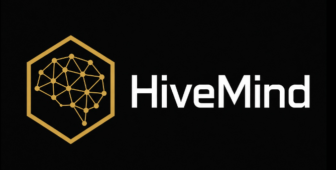
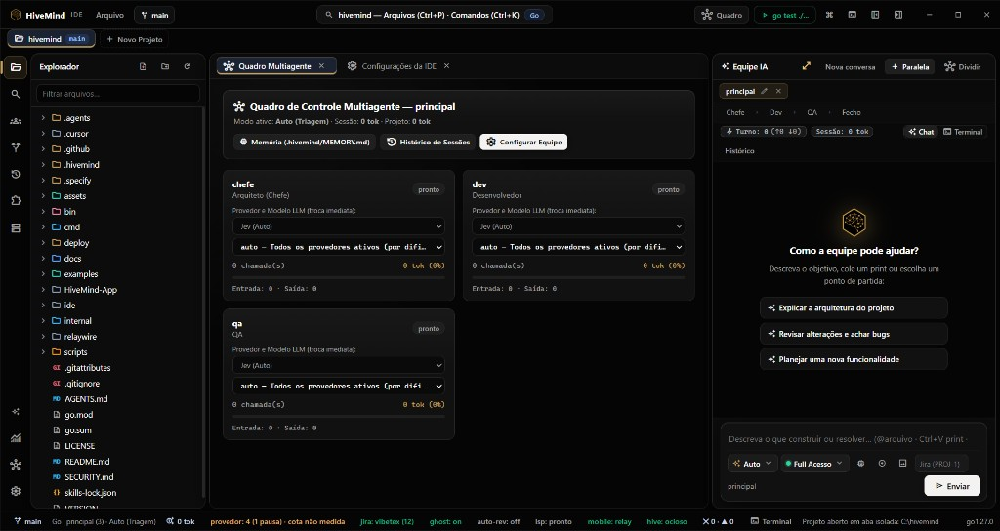
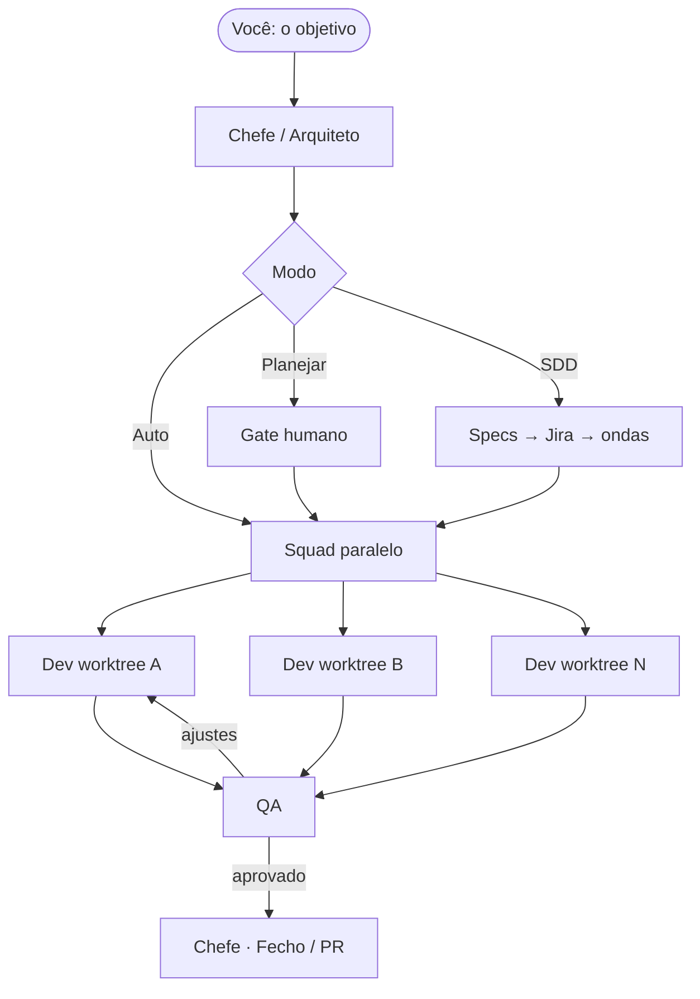
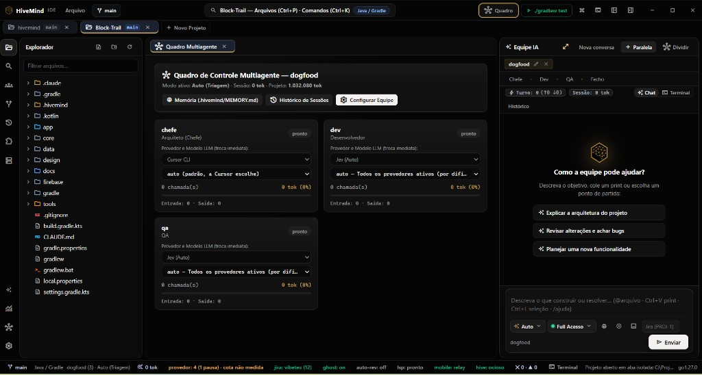
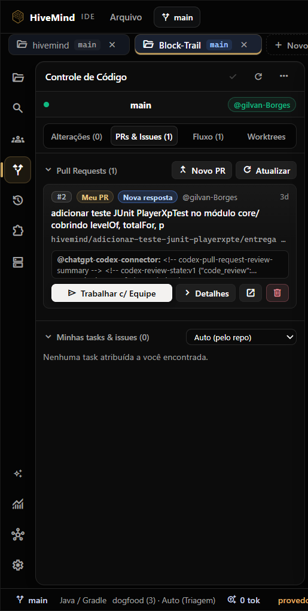
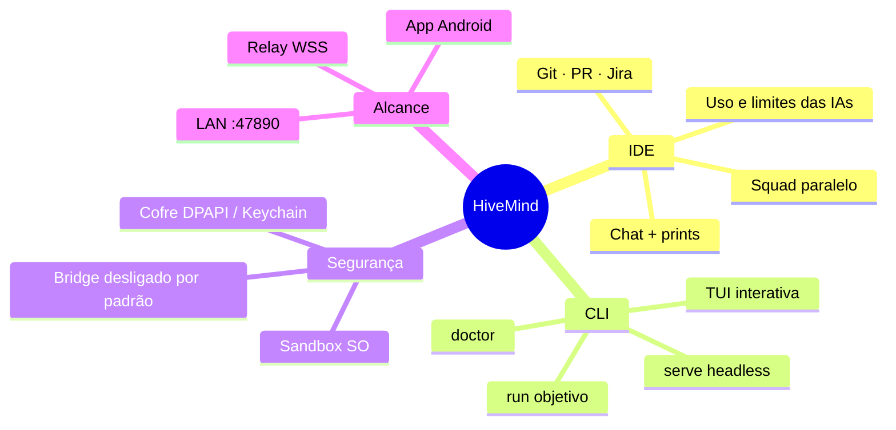
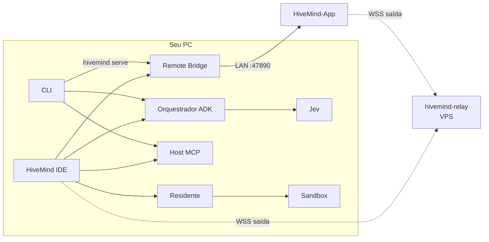
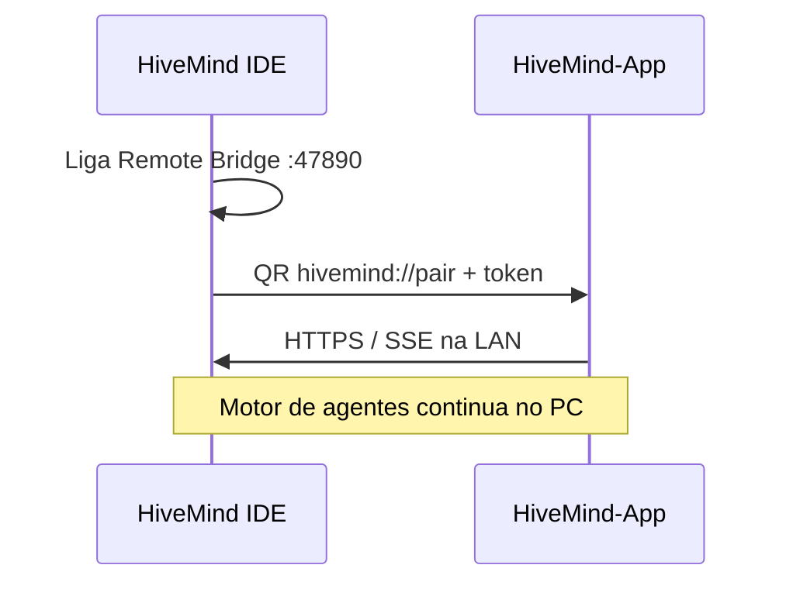
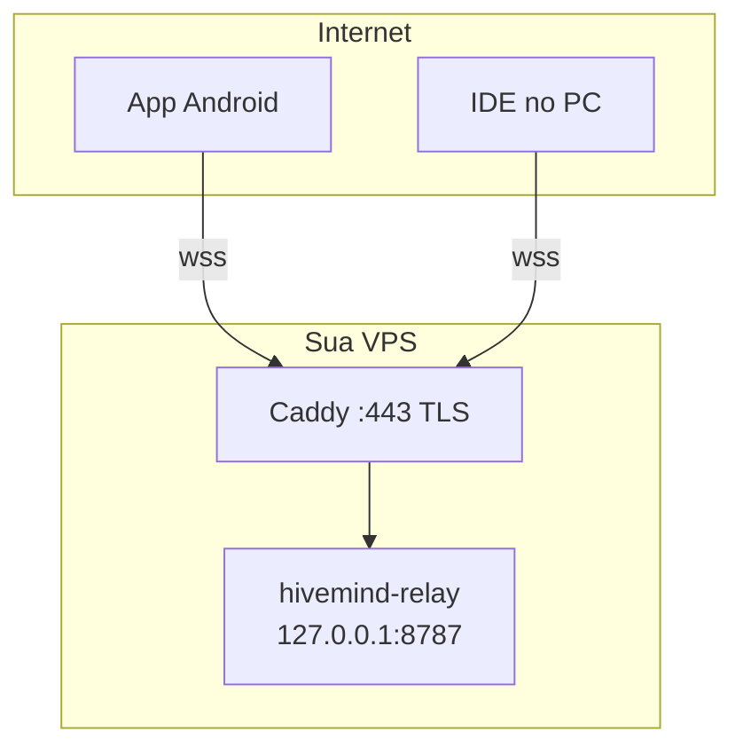
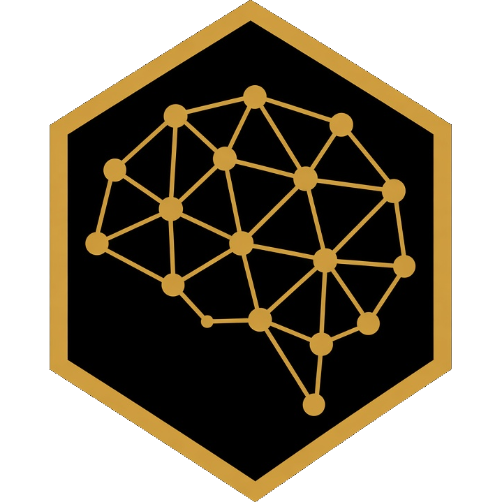

<p align="center">
  
</p>

<p align="center">
  <strong>Um time de agentes de verdade — no PC, no terminal e no bolso.</strong><br/>
  Você descreve o objetivo. O Chefe planeja. Os Devs fatiam. O QA valida.<br/>
  Diffs, PRs, Jira e sandbox no sistema operacional. Sem “copilot que só sugere”.
</p>

<p align="center">
  <a href="https://github.com/gilvan-Borges/hivemind/releases/latest"></a>
  <a href="https://github.com/gilvan-Borges/hivemind/actions/workflows/ci.yml"></a>
  <a href="https://github.com/gilvan-Borges/hivemind/actions/workflows/release.yml"></a>
  
  
</p>

<p align="center">
  <a href="#instala%C3%A7%C3%A3o-em-2-minutos">Instalar</a> ·
  <a href="#o-que-o-hivemind-faz">O que faz</a> ·
  <a href="#remote--app-android">Remote + App</a> ·
  <a href="#relay-fora-da-lan-oracle--vps">Relay</a> ·
  <a href="#documenta%C3%A7%C3%A3o">Docs</a>
</p>

<p align="center">
  
</p>

---

## Por que HiveMind?

Ferramentas de IA costumam ser **um chat**. O HiveMind é um **escritório**: arquiteto, desenvolvedores em paralelo, QA com loop real, revisão de PR, Git/Jira nativos e execução em sandbox do SO.



**O motor fica no seu PC.** Modelos, segredos e o repositório não viajam para um “gateway mágico”. O celular e o relay só mandam ordens cifradas — quem executa é a IDE na sua máquina.

---

## O que o HiveMind faz

| Frente | Para quem | O que entrega |
| --- | --- | --- |
| **HiveMind IDE** | Windows desktop | Editor, chat multimodal, time multiagente, Git/PR, Jira, MCP, uso de IAs, Remote Bridge |
| **CLI `hivemind`** | Terminal (Win / Linux / macOS) | TUI Bubble Tea, `run`, `doctor`, `team`, `serve`, mesmos agentes |
| **HiveMind-App** | Android | Controlar a IDE na LAN ou via relay — [repositório companion](https://github.com/gilvan-Borges/HiveMind-App) |
| **`hivemind-relay`** | VPS / Oracle Always Free | Túnel de saída HTTPS/WSS: app ↔ IDE de qualquer rede |

### Quadro Multiagente

Chefe, Dev e QA no mesmo quadro — provedor e modelo por papel, memória do projeto e histórico de sessão.

<p align="center">
  
</p>

### Controle de Código · PRs

PRs e issues na IDE. **Trabalhar c/ Equipe** manda o time resolver o PR sem sair do HiveMind.

<p align="center">
  
</p>

### Destaques que vendem o produto

- **Time de verdade** — Chefe, Devs em worktrees isoladas, QA com `qa_approve` / `qa_request_changes`
- **Jev** — roteador de modelo com circuit breaker e telemetria de cota
- **Sandbox fechada** — AppContainer/Job Object (Windows), bubblewrap (Linux), Seatbelt (macOS)
- **MCP nativo** — Context7, Code Review Graph e outros no host compartilhado ([docs/MCP.md](docs/MCP.md))
- **Pool de contas** — várias Antigravity / OpenCode / Cursor por organização Git
- **Revisão automática de PR** — lane dedicada (opt-in)
- **Remote** — QR na LAN ou relay E2EE fora de casa



---

## Instalação em 2 minutos

### Windows (recomendado)

1. Abra a **[Latest Release](https://github.com/gilvan-Borges/hivemind/releases/latest)**
2. Baixe **`HiveMindSetup-x64.exe`**
3. Confira o SHA-256 em `checksums.txt` (opcional, mas certo)
4. Instale e abra **HiveMind IDE**

Pronto. A CLI `hivemind` também entra no PATH pelo instalador.

> Cada push verde na `main` publica uma Release automática (workflow **Release**). Sempre use a **Latest**.

### CLI rápida (Linux / macOS / Windows)

Na mesma Release:

| Arquivo | Plataforma |
| --- | --- |
| `hivemind-windows-amd64.exe` | Windows |
| `hivemind-linux-amd64` | Linux x86_64 |
| `hivemind-darwin-amd64` / `hivemind-darwin-arm64` | macOS Intel / Apple Silicon |

```bash
chmod +x hivemind-linux-amd64
./hivemind-linux-amd64 version
./hivemind-linux-amd64 doctor
```

### Compilar do zero (contribuidores)

```powershell
git clone https://github.com/gilvan-Borges/hivemind.git
cd hivemind
powershell -File .\scripts\build-installer.ps1
```

Requisitos: Go **1.26+**, Node **20+**, Wails **v2.17.1**, Inno Setup 6. Detalhes em [ide/README.md](ide/README.md).

---

## Primeiros passos

```powershell
cd C:\projetos\meu-app
hivemind doctor
hivemind team create --name padrao
hivemind
# ou
hivemind run "adicionar um endpoint de healthcheck"
```

Na IDE: abra a pasta do projeto → descreva o objetivo → modo **Auto**, **Planejar** ou **SDD**.

### Configurar modelos

1. Na IDE: **Chaves de API** / **Pool de Contas**
2. Ligue Antigravity (`agy`), OpenCode, Cursor CLI, OpenRouter, etc.
3. Acompanhe cotas em **Uso & Limites das IAs** (página central)

Sem `GOOGLE_API_KEY` e com `agy` no PATH, times novos preferem **agy**.

Exemplo de time: [examples/team.yaml](examples/team.yaml). Config do projeto: `.hivemind/team.yaml` (gitignore).

---

## Arquitetura (visão de produto)



O **relay não executa agentes**. Ele autentica, encaminha quadros cifrados e lista seus PCs. Código, modelos e segredos ficam no desktop.

---

## Remote + App Android

### A) Mesma Wi‑Fi (LAN) — zero servidor



1. Na IDE, ative o chip / painel **Mobile / Remote Bridge**
2. Escaneie o QR `hivemind://pair` no app
3. Token bearer de 256 bits; bridge nasce **desligado** até você ligar

Headless sem janela:

```powershell
hivemind serve
```

Sobe o bridge, mostra o QR no terminal. `Ctrl+C` encerra.

### B) Fora de casa — Relay

IDE e celular só fazem **conexão de saída** (WSS). Você **não** abre porta no roteador de casa.

Contrato: [docs/SPEC_RELAY.md](docs/SPEC_RELAY.md) · Guia completo: [docs/GUIA_ORACLE_RELAY.md](docs/GUIA_ORACLE_RELAY.md)

---

## Relay fora da LAN (Oracle / VPS)

Resumo operacional. Para Always Free Oracle, use o guia longo acima.



### 1. VM + portas

- Ubuntu 24.04 · shape Always Free (ex.: `VM.Standard.E2.1.Micro` x86) ou Ampere (`arm64`)
- Security List **e** `iptables`: TCP **80** e **443** (não exponha 8787)

### 2. DNS

Registro `A` → IP público (`relay.seudominio.com` ou DuckDNS).

### 3. Binário

Baixe `hivemind-relay-linux-amd64` (ou `arm64`) da [Release](https://github.com/gilvan-Borges/hivemind/releases/latest) — **não compile na Micro de 1 GB**.

```bash
sudo useradd --system --create-home --home-dir /var/lib/hivemind-relay --shell /usr/sbin/nologin hivemind
sudo install -m 0755 ./hivemind-relay-linux-amd64 /usr/local/bin/hivemind-relay
sudo install -d -m 0700 -o hivemind -g hivemind /var/lib/hivemind-relay
```

### 4. Ambiente + systemd

```bash
sudo tee /etc/hivemind-relay.env >/dev/null <<'EOF'
HIVEMIND_RELAY_ADDR=127.0.0.1:8787
HIVEMIND_RELAY_DATA=/var/lib/hivemind-relay
HIVEMIND_RELAY_PUBLIC_URL=https://relay.seudominio.com
HIVEMIND_SEED_EMAIL=voce@exemplo.com
HIVEMIND_SEED_PASSWORD=
EOF
sudo chmod 600 /etc/hivemind-relay.env
```

Unit: [`deploy/relay/hivemind-relay.service`](deploy/relay/hivemind-relay.service)

```bash
sudo cp deploy/relay/hivemind-relay.service /etc/systemd/system/
sudo systemctl daemon-reload
sudo systemctl enable --now hivemind-relay
sudo journalctl -u hivemind-relay -n 40 --no-pager
```

Senha gerada aparece uma vez no journal / `initial-password.txt` — copie e apague.

### 5. Caddy (HTTPS)

```bash
# instale o Caddy (ver guia Oracle)
sudo cp deploy/relay/Caddyfile /etc/caddy/Caddyfile   # ajuste o hostname
sudo systemctl reload caddy
curl -sS https://relay.seudominio.com/api/v1/health
```

### 6. Ligar IDE + app

1. IDE → **Acesso remoto** → URL do relay + e-mail/senha → **Entrar**
2. **Ligar acesso remoto** (WebSocket de saída)
3. App: mesma conta → escolher a IDE `online` → trocar chaves públicas E2EE

Docker (host com RAM): `docker build -f deploy/relay/Dockerfile -t hivemind-relay .` — na Micro, prefira binário + Caddy no host.

---

## Estrutura do repositório

| Caminho | Conteúdo |
| --- | --- |
| `cmd/` | `hivemind`, `hivemind-relay` |
| `ide/` | IDE desktop (Go + Wails + TypeScript) |
| `internal/` | Orquestrador, Jev, MCP, residente, sandbox, modelos, Git/GitHub/Jira |
| `relaywire/` | Contrato app ↔ relay ↔ IDE |
| `deploy/relay/` | Dockerfile, Caddyfile, systemd |
| `scripts/` | Instalador Windows |
| `docs/` | Specs e guias |
| `.agents/skills/` | Skills do time |
| `.github/workflows/` | CI + Release automática |

---

## Documentação

| Doc | Assunto |
| --- | --- |
| [docs/MCP.md](docs/MCP.md) | Host MCP e skills |
| [docs/CURSOR_AGENTE.md](docs/CURSOR_AGENTE.md) | Provedor Cursor CLI |
| [docs/SPEC_JEV_ORQUESTRADOR.md](docs/SPEC_JEV_ORQUESTRADOR.md) | Jev |
| [docs/SPEC_HIVE_AGENT.md](docs/SPEC_HIVE_AGENT.md) | Agente residente |
| [docs/SPEC_RELAY.md](docs/SPEC_RELAY.md) | Contrato do relay |
| [docs/GUIA_ORACLE_RELAY.md](docs/GUIA_ORACLE_RELAY.md) | Relay na Oracle Always Free |
| [docs/SPEC_APP_MOBILE_NATIVO.md](docs/SPEC_APP_MOBILE_NATIVO.md) | App + bridge |
| [docs/ROADMAP.md](docs/ROADMAP.md) | Roadmap |
| [ide/README.md](ide/README.md) | Build da IDE |
| [HiveMind-App](https://github.com/gilvan-Borges/HiveMind-App) | Cliente Android |

---

## Segurança (em uma frase e um pouco mais)

Bridge e relay **nascem desligados**. Segredos de provedor ficam fora do Git (`api-keys.json` / cofre). Shell dos agentes limpa env de tokens. Residente usa Credential Manager + DPAPI no Windows (Keychain / Secret Service nos outros). O relay **não** vê o plaintext do plano de dados (NaCl box).

Relatório responsável: ver [SECURITY.md](SECURITY.md).

---

## Licença

[Apache License 2.0](LICENSE).

---

<p align="center">
  <br/>
  <strong>Baixe. Abra o projeto. Descreva o objetivo.</strong><br/>
  <a href="https://github.com/gilvan-Borges/hivemind/releases/latest">→ Latest Release</a>
</p>
