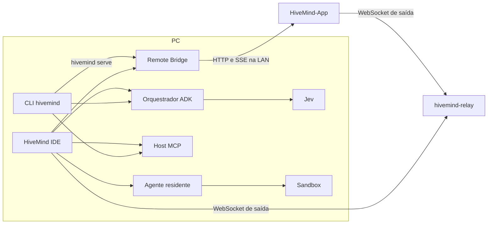

<p align="center">
  
</p>

# HiveMind

Time de software multiagente no terminal e no desktop: você descreve o objetivo na pasta do projeto e o time planeja, implementa e revisa.

[](https://github.com/gilvan-Borges/hivemind/actions/workflows/ci.yml)
[](go.mod)
[](LICENSE)

## O que é

O HiveMind é um módulo Go (`github.com/gilvan-Borges/HiveMind`) com duas frentes no mesmo repositório. A CLI `hivemind` abre uma TUI em Bubble Tea (`charm.land/bubbletea/v2`) ou executa um objetivo até o fim. A [HiveMind IDE](ide/README.md) é o app desktop em Go e Wails v2 (`ide/`, binário `hivemind-ide`). As duas usam o orquestrador em `internal/orchestrator`, em cima do ADK Go (`google.golang.org/adk/v2` v2.8.0): agentes em sequência, em paralelo e em loop.

O time padrão tem Chefe (arquiteto), desenvolvedores e QA. Um time completo pode incluir gerente de projeto e tech lead. A configuração do projeto fica em `.hivemind/team.yaml`. Essa pasta está no `.gitignore`.

## Destaques

- **CLI.** `hivemind` sem argumentos abre a sessão interativa. `run`, `team`, `agent`, `session`, `jira`, `git`, `mcp`, `doctor`, `serve` e `version` são os comandos públicos.
- **IDE.** Desktop Windows em Wails v2.17.1 (`ide/go.mod`), frontend TypeScript/Vite e o mesmo núcleo da CLI. Detalhes em [ide/README.md](ide/README.md).
- **Orquestrador Jev.** Roteador de modelo em `internal/jev`: classifica a tarefa, consulta o catálogo em cache e aplica circuit breaker. A política padrão nasce desligada (`Enabled: false`). O roteamento entra quando a política está ligada ou quando o agente usa o provedor `jev`.
- **Agente residente e sandbox.** Assistente no processo da IDE e no modo headless de `hivemind serve`. A execução de processo passa por `internal/sandboxx` e falha fechada se o mecanismo do sistema não existir: AppContainer e Job Object no Windows, bubblewrap e seccomp no Linux, Seatbelt no macOS.
- **Host MCP.** CLI, IDE e Remote Bridge compartilham `internal/mcpx`. Context7 e Code Review Graph nascem ligados; Playwright, Chrome DevTools, Toolbox, GitHub, Figma Context e Codebase Memory nascem desligados. Guia em [docs/MCP.md](docs/MCP.md).
- **Perfis multi-organização.** Contas de provedor em `provider-profiles.json` (pasta de config do usuário), com regras por organização Git detectadas em `internal/orgx`.
- **Revisão automática.** Na IDE, a aba de fluxo pode revisar pull requests numa lane própria. O modo automático omite `github_merge_pr` e a escrita Git. O interruptor nasce desligado.
- **Skills.** O catálogo nativo semeia `ponytail` e `improve-codebase-architecture`. `untangle-codebase` vai para o disco e nasce desligada. O projeto também lê `.agents/skills/`.
- **Provedores.** `agy` (Antigravity CLI), OpenCode, Gemini, Vertex, Anthropic, OpenAI, OpenAI Responses, OpenRouter e Cursor CLI (`agent`). Sem `GOOGLE_API_KEY` e com `agy` no PATH, o time novo usa `agy`.
- **App Android.** O Remote Bridge e o `hivemind-relay` atendem o [HiveMind-App](https://github.com/gilvan-Borges/HiveMind-App). O código do app não está neste repositório.

## Arquitetura



A CLI e a IDE chamam o mesmo orquestrador. O Jev envolve a fábrica de modelo (`internal/modelx`) quando a política ou o agente pedem roteamento. O residente mora no processo da IDE, com a sandbox do sistema operacional na frente de qualquer comando. O host MCP é o mesmo nas duas frentes.

O Remote Bridge (`ide/internal/remote`) nasce desligado. Na LAN ele escuta a porta **47890**, com token bearer de 256 bits, e publica o pareamento `hivemind://pair`. Fora da rede local, a IDE e o app abrem só conexão de saída para o `hivemind-relay` (`cmd/hivemind-relay`). O relay encaminha; o motor de agentes continua no PC. O processo escuta em `127.0.0.1:8787` por padrão.

## Começar no Windows

Requisitos para compilar: **Go 1.26.10** (`go.mod` e `ide/go.mod`; o workflow usa essa versão) e Git. A IDE também pede Node.js e npm. O script do instalador pede Node.js 20 ou mais novo; o CI usa Node 22. O caminho com Wails CLI pede o comando `wails` no PATH. `ide/go.mod` declara Wails **v2.17.1**.

```powershell
git clone https://github.com/gilvan-Borges/hivemind.git
cd HiveMind
```

### CLI

O workflow e o instalador compilam com `CGO_ENABLED=0`:

```powershell
$env:CGO_ENABLED = "0"
go build -trimpath -ldflags "-s -w" -o hivemind.exe .\cmd\hivemind
.\hivemind.exe version
.\hivemind.exe --help
```

Na pasta de um projeto:

```powershell
cd C:\projetos\meu-app
C:\caminho\HiveMind\hivemind.exe doctor
C:\caminho\HiveMind\hivemind.exe team create --name padrao
C:\caminho\HiveMind\hivemind.exe
C:\caminho\HiveMind\hivemind.exe run "adicionar um endpoint de healthcheck"
```

`doctor` informa o que está configurado e não imprime o valor de segredo. `team create` grava `.hivemind/team.yaml`. Sem argumentos, a CLI abre a TUI. Um exemplo de time está em [examples/team.yaml](examples/team.yaml).

### IDE

O instalador procura o comando `wails` no PATH. A versão declarada em `ide/go.mod` é a v2.17.1:

```powershell
go install github.com/wailsapp/wails/v2/cmd/wails@v2.17.1
```

O texto de erro do script indica `go install github.com/wailsapp/wails/v2/cmd/wails@latest`. Na pasta `ide/`, o instalador compila assim:

```powershell
cd ide
wails build -clean -trimpath -platform windows/amd64
.\build\bin\hivemind-ide.exe --smoke-check
```

O CI, a partir da raiz, gera o executável com o frontend já compilado:

```powershell
cd ide\frontend
npm ci
npm run build
cd ..
go build -tags desktop,production -ldflags "-s -w -H windowsgui" -o build\hivemind-ide.exe .
.\build\hivemind-ide.exe --smoke-check
```

Para abrir a IDE na pasta atual, a partir da raiz do repositório já compilada:

```powershell
.\bin\hivemind-ide.cmd
```

O atalho procura `ide\build\bin\hivemind-ide.exe`, depois `ide\build\hivemind-ide.exe`.

### Instalador

Com Go, Node, npm, `wails` e Inno Setup 6 (`iscc`) no PATH:

```powershell
powershell -File .\scripts\build-installer.ps1
```

O script gera `dist\hivemind.exe` e `dist\HiveMindSetup-x64.exe`. Se o Inno Setup não estiver instalado, a mensagem do script indica `winget install --id JRSoftware.InnoSetup -e`.

### Releases automáticas

Todo **push na `main`** que passar no **HiveMind CI** dispara o workflow **Release**: builda o instalador Windows, CLI (linux/windows/darwin) e relay, e publica uma [GitHub Release](https://github.com/gilvan-Borges/hivemind/releases) (tag `v{VERSION}-{sha}`, marcada como Latest). Também dá para disparar manualmente em Actions → Release → Run workflow.

### Testes locais

```powershell
go test ./...
cd ide
go test ./internal/idecore/...
cd frontend
npm test
```

O workflow **HiveMind CI** (`.github/workflows/ci.yml`) roda `go vet` e `go test` da CLI no Ubuntu (com `-race`) e no Windows, testes da IDE nos dois sistemas e o build do frontend. Publica a CLI para `windows/amd64`, `linux/amd64`, `darwin/amd64` e `darwin/arm64`, a IDE `hivemind-ide.exe` no Windows e o relay para `linux/amd64` e `linux/arm64`. Os artefatos ficam na execução do workflow.

## Linux e macOS

A CLI cruza a mesma receita do CI:

```bash
git clone https://github.com/gilvan-Borges/hivemind.git
cd HiveMind
CGO_ENABLED=0 go build -trimpath -ldflags "-s -w" -o hivemind ./cmd/hivemind
./hivemind version
```

O relay, a partir da raiz:

```bash
CGO_ENABLED=0 go build -trimpath -ldflags "-s -w" -o hivemind-relay ./cmd/hivemind-relay
```

A imagem descrita em `deploy/relay/Dockerfile` é `docker build -f deploy/relay/Dockerfile -t hivemind-relay .`. O passo a passo da VM está em [docs/GUIA_ORACLE_RELAY.md](docs/GUIA_ORACLE_RELAY.md).

## Estrutura

| Caminho | Conteúdo |
| --- | --- |
| `cmd/` | `hivemind` e `hivemind-relay` |
| `ide/` | HiveMind IDE (Go, Wails v2, frontend TypeScript/Vite) |
| `internal/` | Núcleo compartilhado: orquestrador, Jev, modelos, MCP, residente, sandbox, cofre, times, sessões, Git, GitHub e Jira |
| `relaywire/` | Contrato compartilhado entre app, relay e IDE |
| `deploy/relay/` | Dockerfile, Caddyfile, unit systemd e exemplo de ambiente |
| `docs/` | Guias e especificações |
| `examples/` | `team.yaml` de exemplo |
| `scripts/` | Instalador Windows (PowerShell e Inno Setup) |
| `bin/` | `hivemind-ide.cmd` |
| `assets/` | Logo e ícone usados pelo instalador |
| `.agents/` | Skills do projeto lidas pelo time |
| `.github/` | Workflow HiveMind CI |
| `.cursor/` | Configuração do agente Cursor neste repositório |

## Documentação

| Documento | Assunto |
| --- | --- |
| [docs/MCP.md](docs/MCP.md) | Host MCP, servidores e skills nativas |
| [docs/CURSOR.md](docs/CURSOR.md) | Agente do editor Cursor neste repositório |
| [docs/CURSOR_AGENTE.md](docs/CURSOR_AGENTE.md) | Provedor Cursor via CLI `agent` |
| [docs/SPEC_JEV_ORQUESTRADOR.md](docs/SPEC_JEV_ORQUESTRADOR.md) | Desenho do orquestrador Jev |
| [docs/SPEC_HIVE_AGENT.md](docs/SPEC_HIVE_AGENT.md) | Desenho do agente residente |
| [docs/SPEC_RELAY.md](docs/SPEC_RELAY.md) | Contrato do relay |
| [docs/GUIA_ORACLE_RELAY.md](docs/GUIA_ORACLE_RELAY.md) | Relay na Oracle Cloud Always Free |
| [docs/SPEC_APP_MOBILE_NATIVO.md](docs/SPEC_APP_MOBILE_NATIVO.md) | Remote Bridge e o app Android |
| [docs/SPEC_AUTO_REVIEW_FLUXO.md](docs/SPEC_AUTO_REVIEW_FLUXO.md) | Revisão automática de pull requests |
| [docs/SPEC_REVISAO_CONTEXTO.md](docs/SPEC_REVISAO_CONTEXTO.md) | Revisão de diff e compactação de contexto |
| [docs/ROADMAP.md](docs/ROADMAP.md) | Fases do produto |
| [docs/DOGSFOODING.md](docs/DOGSFOODING.md) | Protocolo de uso real da IDE |
| [ide/README.md](ide/README.md) | Build e uso da IDE |

## App Android

O cliente móvel é o repositório [github.com/gilvan-Borges/HiveMind-App](https://github.com/gilvan-Borges/HiveMind-App). Este repositório é o lado do PC.

Na IDE, o chip do app controla o Remote Bridge. Ele permanece desligado até `SetMobileBridgeEnabled`. O pareamento é um QR `hivemind://pair` com as URLs locais e o token. `hivemind serve` localiza o `hivemind-ide` e o executa com `--serve-bridge`: o bridge sobe naquele processo, sem a janela, e o terminal mostra o QR. Ctrl+C encerra.

Fora da LAN, a IDE abre um túnel de saída no relay. O contrato está em [docs/SPEC_RELAY.md](docs/SPEC_RELAY.md) e [docs/SPEC_APP_MOBILE_NATIVO.md](docs/SPEC_APP_MOBILE_NATIVO.md).

## Segurança

Segredos do agente residente passam por `internal/secretx`. No Windows o cofre é o Credential Manager (`CredWriteW`), com o valor protegido por DPAPI (`CryptProtectData`), no alvo `HiveMind:resident:`. Se o cofre não estiver disponível, a operação falha fechada. O pacote não grava o valor em log, prompt nem telemetria. No macOS o mesmo pacote usa o Keychain; no Linux, o Secret Service.

Chaves de provedor que a IDE persiste (`CURSOR_API_KEY`, `OPENROUTER_API_KEY`, `OPENAI_API_KEY`, `ANTHROPIC_API_KEY`, `GOOGLE_API_KEY` e as variáveis de projeto listadas em `internal/modelx/keys.go`) ficam em `api-keys.json` na pasta de config do usuário, fora do Git. Variável de ambiente, quando existe, prevalece sobre o arquivo.

O Remote Bridge nasce com `enabled: false`. A config fica em `%LOCALAPPDATA%\HiveMind\remote-bridge.json`, modo `0600`, com token de 256 bits. Toda rota `/api/v1/*` exige o token, comparado em tempo constante, exceto `GET /api/v1/health`. O cliente do relay (`relay.json`, ao lado desse arquivo) também nasce desligado.

Comandos de shell dos agentes recebem o ambiente de `internal/shellx`: variáveis com sufixo de token, segredo, senha ou chave de API saem do ambiente do processo.

## Licença

[Apache License 2.0](LICENSE).
