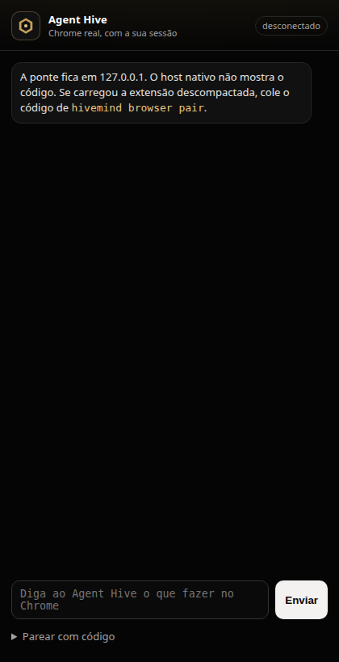

# Extensão Chrome do Agent Hive

O Agent Hive dirige o Chrome que você já usa: a sessão, os cookies e as abas continuam os seus. O modelo pede uma ação, o HiveMind confere a permissão e a extensão executa com o depurador do Chrome (clique, teclado, árvore de acessibilidade, screenshot, console, rede, DOM e estilos).

A ponte **não** usa o Remote Bridge da porta 47890. Aquele escuta na rede local para o app. O controle do browser escuta só em `127.0.0.1:47891`. Nada disso é anunciado para fora da máquina.

## Por que native messaging e não o bridge da LAN

O caminho robusto é o host native messaging.

1. `hivemind browser install` grava o manifesto do host `com.gilvan_borges.hivemind` (registro no Windows; no Linux e no macOS, a pasta NativeMessagingHosts do Chrome, do Chrome for Testing e do Chromium) e um executável `hivemind-browser-host`, que é o próprio `hivemind` entrando no modo stdio.
2. A extensão fala com esse host. O host lê o token do arquivo local (permissão 0600) e abre `ws://127.0.0.1:47891/browser`.
3. O token não entra na extensão, nem na URL, nem no log.

O WebSocket em loopback é o miolo, porque o servidor MCP vive dentro do processo do HiveMind (IDE, `hivemind serve` ou `hivemind browser serve`) e o Chrome sobe o host como outro processo. O host só encaminha.

Se você carregou a pasta descompactada e ainda não registrou o host, o side panel aceita o código de `hivemind browser pair`. Esse código também só conversa com `127.0.0.1`. É o caminho de desenvolvimento. O host nativo continua sendo o de uso normal.

A opção menor, se um dia quiser cortar o instalador do host, é ficar só com o WebSocket de loopback e o código colado no painel.

## Instalar

1. Build da extensão, na pasta `extension/chrome`:

   ```bash
   npm ci
   npm test
   npm run build
   ```

   Isso gera `extension/chrome/dist` (Load unpacked) e `extension/chrome/hivemind-chrome-extension.zip`. O zip também sai na Release como `hivemind-chrome-extension.zip`.

2. No Chrome: `chrome://extensions`, modo desenvolvedor, **Carregar sem compactação** e escolha `extension/chrome/dist`. O id da extensão é estável por causa da chave pública no manifesto (`jepaepopiknbiklfmjmdagpoppgnhaml`). A chave privada não está no repositório.

3. No terminal, com o `hivemind` que você vai usar de verdade:

   ```bash
   hivemind browser install
   ```

4. Abra a IDE, ou rode `hivemind serve`, ou `hivemind browser serve`. Um processo só é o dono da porta. Os outros entram como cliente.

5. Clique no ícone da extensão para abrir o side panel. O estado fica **conectado · host nativo**. Sem o host, cole o código:

   ```bash
   hivemind browser pair
   ```

   `hivemind browser status` mostra a porta, se a extensão está ligada e os sites já permitidos. Não imprime o código.

## Ferramentas

O servidor MCP `hivemind-browser` nasce desligado, como o Playwright. O agente liga com `mcp_enable_server` (a IDE e o app Android recebem o `approval_required` de sempre). No fim da tarefa o esquema sai do prompt. A ponte pode continuar no ar para o side panel.

Ele não convive com `playwright` nem com `chrome-devtools`. Ligar um desliga os outros.

| Ferramenta | O que faz |
| --- | --- |
| `navigate` | Abre http(s) na aba atual |
| `read_page` | Árvore de acessibilidade com refs `e1`, `e2`… |
| `find` | Filtra a árvore por texto |
| `click` | Clica numa ref ou em coordenadas, com evento real de mouse |
| `type` | Foca a ref e insere texto |
| `form_input` | Preenche um campo. `submit: true` pede aprovação |
| `scroll` | Roda do mouse |
| `key` | Tecla (Enter, Tab, setas, um caractere) |
| `screenshot` | JPEG da aba para o agente ver a tela |
| `tabs_list` / `tabs_create` / `tabs_close` / `tabs_switch` | Abas |
| `console_read` | Últimos logs do console |
| `network_read` | Método, URL filtrada e status. Sem cookie e sem Authorization |
| `get_dom` | HTML externo, truncado |
| `computed_styles` | Cor, fonte, display e caixa da ref |
| `javascript_exec` | JavaScript na página. Sempre pede aprovação |
| `wait` | Até 10s, ou até um texto aparecer |

Enquanto uma chamada está em curso, a aba ganha uma borda dourada e o selo ON. O botão **Parar o agente** no side panel corta a ação e solta o depurador.

O chat do side panel vira um turno na IDE (lane `lane-hive`) ou no `hivemind serve` (lane `lane-browser`). Se já houver execução, a mensagem entra como steer.

## Segurança

- Allowlist por host. O primeiro `navigate` ou `tabs_create` de um site pede aprovação. O sim grava só o hostname em `browser-bridge.json`, ao lado da config do usuário, modo 0600. `file:`, `javascript:` e URL com usuário são recusados.
- Envio de formulário, clique em comprar/pagar/assinar/excluir conta e `javascript_exec` pedem aprovação de novo, toda vez. A extensão também olha o nome acessível do elemento: se o modelo não marcou o clique como sensível, ela devolve `needs_approval` e não clica.
- Sem aprovador (modo que não consegue perguntar), a ação sensível é negada.
- O resultado passa por um redator de `Bearer`, prefixos conhecidos de token e o próprio código da ponte.
- Log e `browser status` não carregam o token. O health `GET /health` também não.
- A permissão `<all_urls>` do Chrome existe para o depurador alcançar a aba depois que você aprovou o site. Quem decide o site é o HiveMind, não a página.

## Como ficou

A borda dourada e o selo aparecem na aba enquanto o agente opera. O print abaixo é o Chrome headless preenchendo um formulário local e clicando em Salvar.


O side panel, no mesmo tema escuro do HiveMind. Este print é a página do painel aberta à parte, por isso o estado está desconectado.



## Limites

- Um HiveMind dono da porta. IDE e `hivemind serve` ao mesmo tempo: quem ligou primeiro recebe o chat do painel.
- A extensão não dirige o Chrome de outro usuário nem um Chrome remoto.
- Screenshot grande demais é omitido (teto perto de 700 KB, o limite do native messaging).
- `javascript_exec` roda de verdade na página. A aprovação é o portão; o retorno pode ter dado da página e por isso é truncado e redatado.
- Publicar na Chrome Web Store exige uma chave de assinatura que este repositório de propósito não tem. Load unpacked e o zip da Release usam a chave pública só para o id ficar estável.
