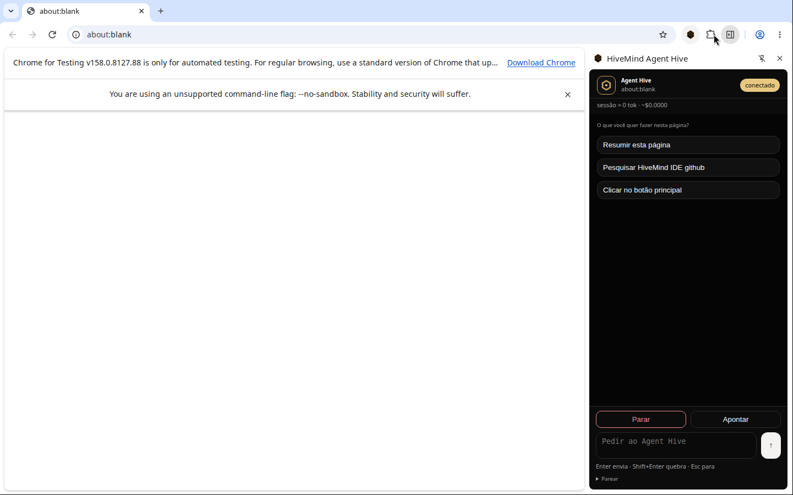
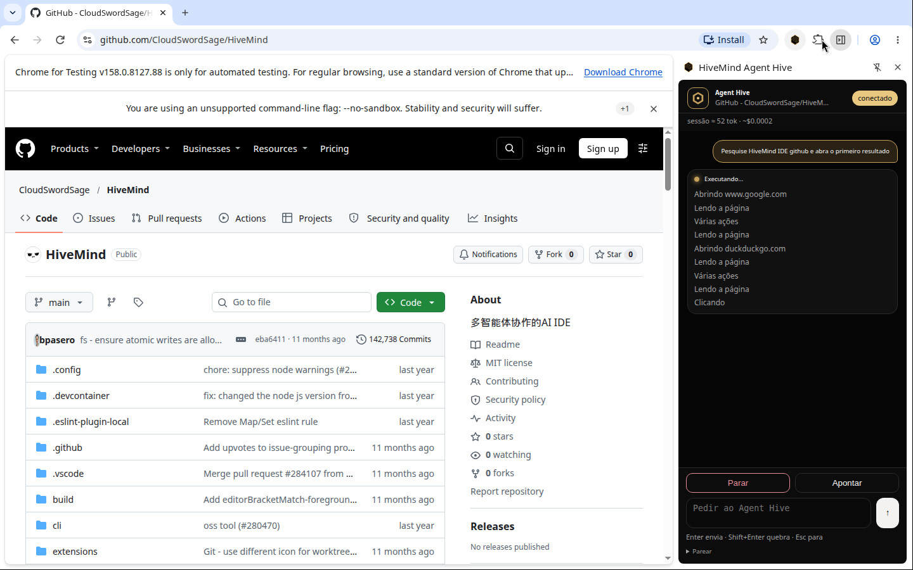
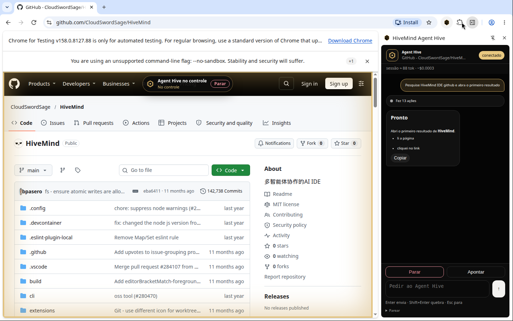
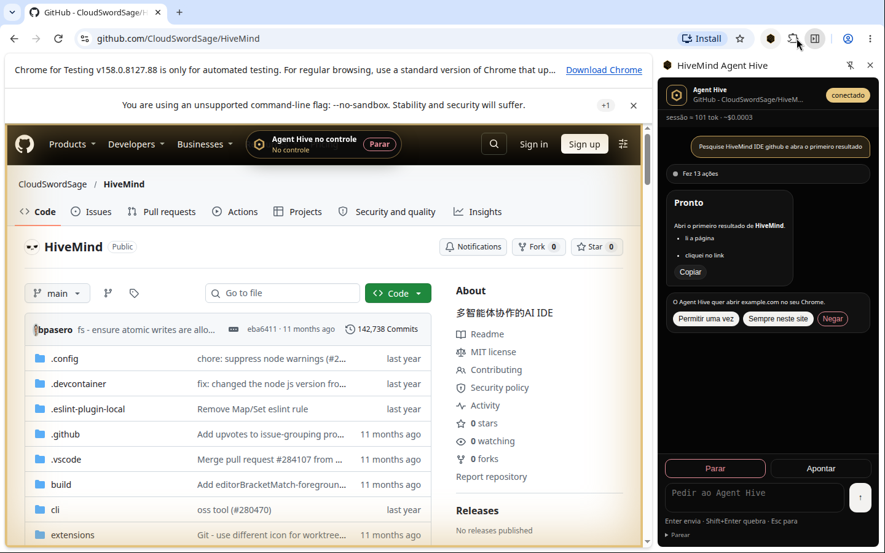
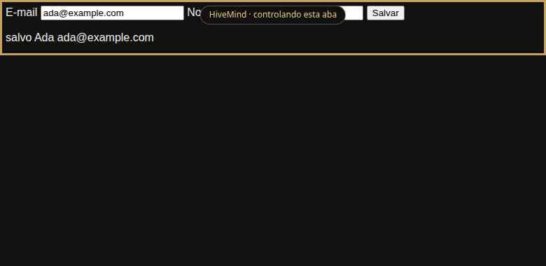

# Extensão Chrome do Agent Hive

O Agent Hive dirige o Chrome que você já usa: a sessão, os cookies e as abas continuam os seus. O modelo pede uma ação, o HiveMind confere a permissão e a extensão executa com o depurador do Chrome (clique, teclado, árvore de acessibilidade, screenshot, console, rede, DOM e estilos).

A ponte **não** usa o Remote Bridge da porta 47890. Aquele escuta na rede local para o app. O controle do browser escuta só em `127.0.0.1:47891`. Nada disso é anunciado para fora da máquina.

## Por que native messaging e não o bridge da LAN

O caminho robusto é o host native messaging.

1. `hivemind browser install` grava o manifesto do host `com.gilvan_borges.hivemind` (registro no Windows; no Linux e no macOS, a pasta NativeMessagingHosts do Chrome, do Chrome for Testing e do Chromium) e um executável `hivemind-browser-host`, que é o próprio `hivemind` entrando no modo stdio.
2. A extensão fala com esse host. O host lê o token do arquivo local (permissão 0600) e abre `ws://127.0.0.1:47891/browser`.
3. O token não entra na extensão, nem na URL, nem no log.

O WebSocket em loopback é o miolo, porque o servidor MCP vive dentro do processo do HiveMind (IDE, `hivemind serve` ou `hivemind browser serve`) e o Chrome sobe o host como outro processo. O host só encaminha.

Se você carregou a pasta descompactada e ainda não registrou o host, o side panel aceita o código de `hivemind browser pair`. Esse código também só conversa com `127.0.0.1`. É o caminho de desenvolvimento. O host nativo continua sendo o de uso normal.

A opção menor, se um dia quiser cortar o instalador do host, é ficar só com o WebSocket de loopback e o código colado no painel.

## Instalar

1. Build da extensão, na pasta `extension/chrome`:

   ```bash
   npm ci
   npm test
   npm run build
   ```

   Isso gera `extension/chrome/dist` (Load unpacked) e `extension/chrome/hivemind-chrome-extension.zip`. O zip também sai na Release como `hivemind-chrome-extension.zip`.

2. No Chrome: `chrome://extensions`, modo desenvolvedor, **Carregar sem compactação** e escolha `extension/chrome/dist`. O id da extensão é estável por causa da chave pública no manifesto (`jepaepopiknbiklfmjmdagpoppgnhaml`). A chave privada não está no repositório.

3. No terminal, com o `hivemind` que você vai usar de verdade:

   ```bash
   hivemind browser install
   ```

4. Abra a IDE, ou rode `hivemind serve`, ou `hivemind browser serve`. Um processo só é o dono da porta. Os outros entram como cliente.

5. Clique no ícone da extensão para abrir o side panel. O estado fica **conectado · host nativo**. Sem o host, cole o código:

   ```bash
   hivemind browser pair
   ```

   `hivemind browser status` mostra a porta, se a extensão está ligada e os sites já permitidos. Não imprime o código.

## Ferramentas

O servidor MCP `hivemind-browser` nasce desligado. O Playwright nasce ligado; ligar a extensão desliga o Playwright. O agente liga com `mcp_enable_server` (a IDE e o app Android recebem o `approval_required` de sempre). No fim da tarefa o esquema sai do prompt. A ponte pode continuar no ar para o side panel.

Ele não convive com `playwright` nem com `chrome-devtools`. Ligar um desliga os outros.

| Ferramenta | O que faz |
| --- | --- |
| `navigate` | Abre http(s) na aba atual. A resposta é `ok`, título e host |
| `read_page` | Só o que está no viewport e é interativo, com refs `e1`, `e2`… Texto truncado, repetidos colapsados (`×N`) e paginação (`limit`, `offset`). Sem mudança devolve `igual`. `view=delta` devolve só o que mudou. `scope=all` inclui o resto |
| `find` | Até 6 candidatos por texto e `role` |
| `get_page_text` | Texto do miolo (`article`/`main`), com `limit` |
| `click` / `type` / `form_input` / `scroll` / `key` | Ação real. A resposta é curta e, se a árvore mudou pouco, traz o delta. Ref obsoleta é relida pelo papel e pelo nome. O alvo entra na tela antes do clique |
| `batch` | Até 15 dessas ações numa chamada (preencher um formulário) |
| `screenshot` | Só quando o agente pede. JPEG (ou WebP) do viewport, `quality` e `scale`. Não vai anexado nas outras ferramentas |
| `tabs` | `action` `list`, `create`, `close` ou `switch` |
| `wait` | Rede ociosa e DOM estável, ou até um texto aparecer. Sem `sleep` fixo |
| `dialog` | `alert`/`confirm`/`prompt`. Aceitar pede aprovação |
| `pick` | A pessoa aponta um elemento na página |
| `devtools` | Passa a valer `console_read`, `network_read`, `get_dom`, `computed_styles`, `javascript_exec` e `upload`. Console e rede voltam filtrados (erros, regex, limite) |

`console_read`, `network_read`, `get_dom`, `computed_styles`, `javascript_exec` e `upload` continuam chamáveis, mas o esquema deles não entra no prompt até o agente chamar `devtools`. Os nomes antigos `tabs_list`, `tabs_create`, `tabs_close` e `tabs_switch` ainda funcionam na ponte.

Uma ação que abre aba nova passa a aba para o agente. Download aparece numa linha do resultado. `upload` manda arquivos para um `<input type=file>` e pede aprovação. Iframe entra na árvore quando o Chrome entrega a sessão; shadow DOM entra na lista do que está visível.

O histórico do agente, antes de ir ao modelo, troca saídas antigas de `read_page`, `get_page_text`, `screenshot`, console, rede, DOM e JavaScript por uma linha. A última fica. A extensão também guarda a árvore por URL e hash: a segunda leitura igual não reenvia a página.

## Tokens

Conta é bytes ÷ 4, a mesma do compactador de contexto. Para repetir:

```bash
cd extension/chrome && npm ci && npm test && npm run bench
go test -count=1 -run 'TestCatalogShrinks|TestPruneBrowser' -v ./internal/browserx/ ./internal/contextx/
```

Página sintética (nav repetida, 80 links, 250 parágrafos, 200 nós genéricos). A coluna "antes" é o formatador da v1, que listava até 700 nós.

| Cenário | Antes | Depois | Economia |
| --- | ---: | ---: | ---: |
| `read_page` | 13828 tok | 549 tok | 96% |
| `read_page` sem mudança | 13828 tok | 7 tok | ~100% |
| delta depois da ação | 13828 tok | 5 tok | ~100% |
| `find` | 928 tok | 135 tok | 85% |
| console (só erro/aviso) | 787 tok | 11 tok | 99% |
| rede (só 4xx/5xx) | 357 tok | 8 tok | 98% |
| esquema no prompt | 684 tok (2736 bytes) | 429 tok (1713 bytes) | 37% |
| 3 `read_page` no histórico | 1020 tok | 374 tok | 63% |
| screenshot da aba (base64) | 63800 caracteres, q40 escala 1 | 16888 caracteres, q28 escala 0,5 | 74% |

O esquema novo é menor mesmo com `batch`, `get_page_text`, `dialog`, `pick` e `devtools`, porque console, rede, DOM, estilos, JavaScript e upload saíram do prompt. No histórico de teste, duas leituras de 1360 bytes viram uma linha e saem 2586 bytes; a terceira leitura fica inteira.

Enquanto o agente controla a aba, um overlay em shadow DOM mostra um brilho dourado pulsante, um cursor fantasma até o clique, o contorno do alvo e um pill "Agent Hive no controle" com Parar. O resto do overlay não recebe clique (`pointer-events: none`). `prefers-reduced-motion` desliga a animação. O screenshot que o agente usa para decidir esconde o overlay; os prints de demonstração mostram ele. O botão **Parar** do pill e o do side panel cortam a ação e soltam o depurador.

O chat do side panel vira um turno na IDE (lane `lane-hive`) ou no `hivemind serve` (lane `lane-browser`). Se já houver execução, a mensagem entra como steer. A resposta volta em markdown e aparece em partes quando passa de 80 caracteres. Os passos da mesma leva ficam num grupo fechado ("Fez N ações"). Miniatura só no `screenshot`. Aprovação de ação sensível aparece no fio: Permitir uma vez, Sempre neste site, Negar. Enter envia, Shift+Enter quebra a linha, Esc pede parada. O Parar corta a chamada na ponte, marca a ferramenta como interrompida e solta o depurador. O painel mostra a aba atual, uma estimativa de tokens da sessão (preço de referência US$ 3 por milhão) e sugestões quando a conversa daquela aba ainda está vazia. O histórico fica por aba. Apontar pede um clique na página e cola o elemento no campo. Erro de passo ou de turno tem Tentar de novo.

## Segurança

- Allowlist por host. O primeiro `navigate` ou `tabs_create` de um site pede aprovação. O sim grava só o hostname em `browser-bridge.json`, ao lado da config do usuário, modo 0600. `file:`, `javascript:` e URL com usuário são recusados.
- Envio de formulário, clique em comprar/pagar/assinar/excluir conta e `javascript_exec` pedem aprovação de novo, toda vez. A extensão também olha o nome acessível do elemento: se o modelo não marcou o clique como sensível, ela devolve `needs_approval` e não clica.
- Sem aprovador (modo que não consegue perguntar), a ação sensível é negada.
- O resultado passa por um redator de `Bearer`, prefixos conhecidos de token e o próprio código da ponte.
- Log e `browser status` não carregam o token. O health `GET /health` também não.
- A permissão `<all_urls>` do Chrome existe para o depurador alcançar a aba depois que você aprovou o site. Quem decide o site é o HiveMind, não a página.

## Conversa no side panel

A janela inteira, com a aba e o painel, no tema escuro dourado.









O GIF da janela está em `docs/screenshots/chrome-v2-demo.gif`.

## Como ficou

A borda dourada e o selo aparecem na aba enquanto o agente opera. O print abaixo é o Chrome headless preenchendo um formulário local e clicando em Salvar.



O side panel, no mesmo tema escuro do HiveMind. Este print é a página do painel aberta à parte, por isso o estado está desconectado.


## Limites

- Um HiveMind dono da porta. IDE e `hivemind serve` ao mesmo tempo: quem ligou primeiro recebe o chat do painel.
- A extensão não dirige o Chrome de outro usuário nem um Chrome remoto.
- Screenshot grande demais é omitido. A extensão refaz em JPEG menor e recusa acima de ~120 KB; a ponte ainda corta em 700 KB, o teto do native messaging.
- `javascript_exec` roda de verdade na página. A aprovação é o portão; o retorno pode ter dado da página e por isso é truncado e redatado.
- Publicar na Chrome Web Store exige uma chave de assinatura que este repositório de propósito não tem. Load unpacked e o zip da Release usam a chave pública só para o id ficar estável.
