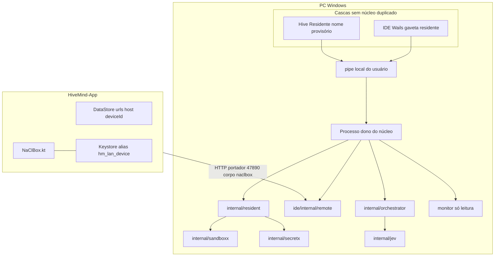
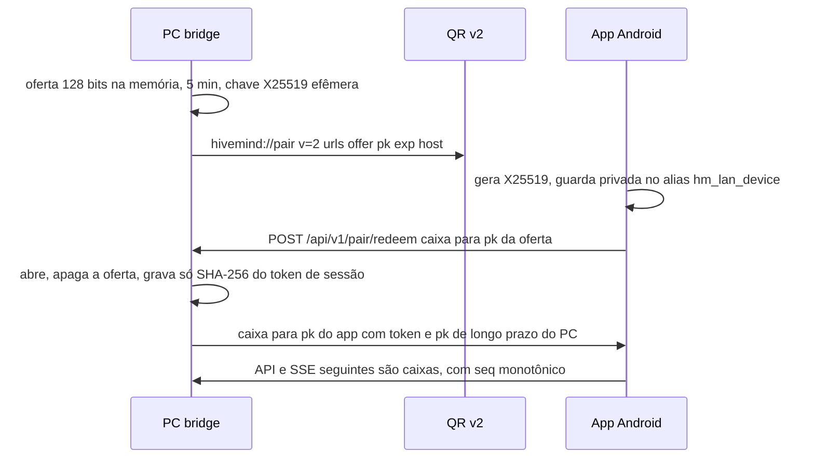
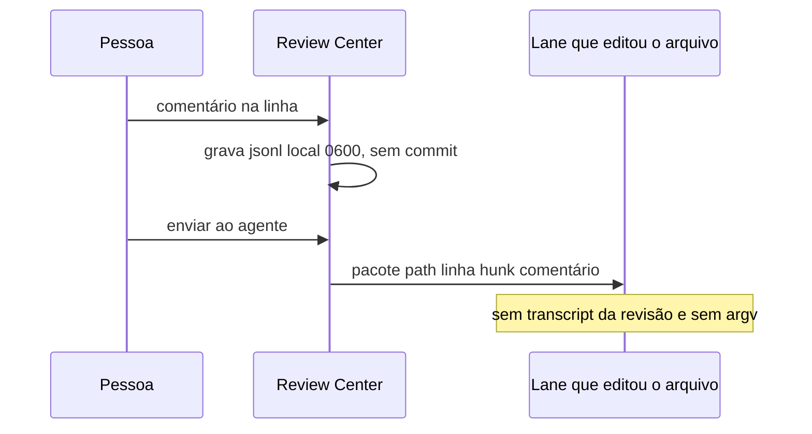

# Spec — Atualização HiveMind (pareamento seguro, residente fora da IDE, revisão)

**Status:** proposta. Este arquivo não altera código. O que está descrito como comportamento atual foi lido no repositório; o que é desenho novo está marcado como proposta. O que não foi verificado está marcado como **desconhecido**.
**Data:** 2026-11-20
**Idioma:** português (Brasil)

**Escopo deste documento**

| Superfície | Onde o código mora hoje |
| --- | --- |
| IDE e bridge | este repositório (`ide/`, `internal/`) |
| Relay | `cmd/hivemind-relay`, `relaywire/`, `internal/relay/` |
| App Android | repositório `gilvan-Borges/HiveMind-App` (pacote `dev.hivemind.mobile`) |
| Nome da casca nova | **Hive Residente (nome provisório)**. O nome final ainda não existe. |

`docs/SPEC_HIVE_AGENT.md` decisão 1 diz que o residente mora no processo que já existe e que não há segundo daemon. Esta spec **substitui só essa decisão de processo de interface**. Os pacotes `internal/resident`, `internal/sandboxx` e `internal/secretx` continuam sendo o único núcleo. Não se copia a lógica para outro módulo.

---

## 1. Problema

O HiveMind já comanda equipes no PC, fala com o celular e tem um assistente residente dentro da IDE. Quatro buracos aparecem quando se compara isso com o uso real:

1. **O pareamento LAN entrega o segredo de longo prazo e o plano de dados em claro.** O bridge escuta `0.0.0.0` na porta 47890 (`ide/internal/remote/server.go`, `Start`). O QR `hivemind://pair` leva o token de 256 bits (`ide/internal/remote/qr.go`, `BuildPairURI`). Esse token é gravado em claro em `%LOCALAPPDATA%\HiveMind\remote-bridge.json` (`ide/internal/remote/config.go`). O modo headless imprime o token no stdout (`ide/internal/remote/host.go`, `RunHeadless`). No Android, `PairingStore` grava a chave `token` no DataStore `hivemind_pairing` (`HiveMind-App`, `core/store/PairingStore.kt`) e o manifesto tem `android:usesCleartextTraffic="true"` (`app/src/main/AndroidManifest.xml`). O relay, no outro caminho, já cifra com `naclbox` e só guarda hash (`docs/SPEC_RELAY.md`, `relaywire/e2e.go`, `internal/relay/store.go` `tokenHash`).
2. **O residente só existe como gaveta da IDE.** Chat, Segurança & Cofre, Memória Pessoal e Auditoria estão em `ide/frontend/src/resident.ts`. Sem a janela Wails, a pessoa não usa essa superfície. `hivemind serve` sobe o mesmo binário da IDE em `--serve-bridge` (`internal/cli/servecmd.go`, `ide/main.go`) e não desenha orb, bandeja nem paleta global.
3. **Revisão e passagem de contexto ainda são texto largo.** O diff da IDE (`ide/internal/idecore/diff.go`) lista hunks e sabe aceitar ou reverter um hunk. Não há comentário por linha devolvido ao agente que produziu a mudança. O dossiê em `.hivemind/handoff/*.md` (`internal/orchestrator/orchestrator.go`, `writeHandoffDossier`) é markdown livre, modo `0644`, com o plano e o brief que o Chefe escreveu.
4. **Sessões abertas fora do HiveMind não entram no modelo.** `agy`, Claude Code, Codex e OpenCode são provedores que o Hive **chama** (`internal/modelx/factory.go`). Não há descoberta de um processo que a pessoa abriu sozinha, nem estado normalizado, nem ação condicionada ao que o adaptador realmente faz.

A cota do Jev é um caso à parte e **não é um buraco total**. A seção 11 registra o que já troca de provedor e o que ainda falta.

---

## 2. Objetivos

1. Parear o app Android com um QR de uso único, válido por 5 minutos, sem colocar o token de sessão no QR nem em claro no disco do PC. O corpo de API e de SSE na LAN sai cifrado com o mesmo `naclbox` que o relay já usa.
2. Observar sessões de agentes abertas fora do HiveMind, somente leitura por padrão, com ação só quando o adaptador declara que sabe executá-la.
3. Abrir o Hive Residente (nome provisório) sem abrir a IDE: processo leve, Windows primeiro, orb na borda da tela, paleta global, terminais flutuantes de leitura, ícone de bandeja. O núcleo, o cofre e a auditoria são os que já existem.
4. Comentar uma linha de diff e devolver esse comentário ao agente que produziu a mudança, com um pacote pequeno.
5. Passar entre papéis um pacote estruturado, e recusar uma aresta que fecharia um ciclo fora do loop Dev→QA que já existe.
6. Deixar de gravar comando, caminho e payload de permissão em claro na auditoria durável, e deixar o plano dos documentos de privacidade e de ameaças.
7. Completar só o buraco real do Jev: aviso antes do esgotamento e medidor onde hoje não há percentual. Não criar um segundo motor de failover.
8. Registrar instalação, APK em GitHub Releases, atualização assinada e CI multi-SO como fase adiada. Esta spec não executa essa fase.

## 3. Não-objetivos

- Python em qualquer parte nova. O CI de hoje é Go e o frontend npm da IDE (`.github/workflows/ci.yml`).
- iOS, macOS App Store, ou qualquer binário Apple de interface. O CI já cruza `darwin` só para o binário da CLI (`build-cli`). Isso permanece. Não nasce app Apple.
- Modo demonstração, dados fictícios de sessão, ou botão que finge uma ação.
- Enfraquecer `internal/sandboxx` ou `internal/secretx`. O mecanismo Windows continua `appcontainer+jobobject` (`internal/sandboxx/sandbox_windows.go`). O cofre continua no cofre do sistema (`internal/secretx/vault.go`). Não há flag de “rodar mesmo assim”.
- `shell: true`, `sh -c`, `bash -c`, `cmd /c`, `powershell -Command`. O residente já recusa esses interpretadores (`internal/resident/exec_guard.go`). Processo novo usa `argv` explícito, no mesmo espírito de `sandboxx.ValidateArgv`.
- Abrir pull request. O dono determinou trabalho direto em `main`.
- Marketplace de skills, segundo cofre, segundo sandbox, ou segundo ledger de tokens ao lado de `internal/modelx/usage.go`.
- Controle de mouse e teclado na sessão real da pessoa. `docs/SPEC_HIVE_AGENT.md` seção 9 já deixa isso desligado.
- Ramificação livre de workflow em canvas. O orquestrador continua o loop ADK que já existe (`internal/orchestrator/orchestrator.go`).

---

## 4. Ordem para quem for executar

A ordem é a do risco, não a da lista original. Cada fase fecha sozinha. Não se antecipa a fase seguinte.

| Ordem | Fase | Motivo de estar aqui |
| --- | --- | --- |
| 1 | Pareamento LAN cifrado | O token de longo prazo e o plano de dados saem em claro na rede local hoje. |
| 2 | Auditoria sem comando/caminho em claro, e os dois documentos de política | O log durável ainda guarda o alvo (`internal/resident/fence.go`, `RedactTarget`). |
| 3 | Aviso de cota do Jev | O failover entre provedores já existe no caminho do squad. Falta o aviso e o percentual onde a sonda não mede. |
| 4 | Handoff sanitizado e recusa de ciclo | O loop Dev→QA já tem teto. Falta o pacote e a recusa explícita fora dele. |
| 5 | Review Center | Depende do pacote da fase 4 para não reinventar a mensagem ao agente. |
| 6 | Monitor de sessões externas, só leitura | Não há adaptador real de ação ainda. Ligar botão agora mentiria. |
| 7 | Manifesto JSON de detector | Subfase opcional da 6. Sem a 6, o manifesto não tem hospedeiro. |
| 8 | Hive Residente (nome provisório) fora da IDE | O núcleo já funciona na gaveta. A casca é processo novo e IPC. |
| 9 | Releases | Adiada. Não executar. |

### Regras fechadas do executor

1. Windows nativo primeiro. Linux entra no mesmo pacote com falha fechada, como `sandboxx` já faz. Sem alvo iOS.
2. Sem Python. Sem modo demonstração.
3. Commit direto em `main`. Sem branch de feature e sem pull request, salvo se `main` recusar o push. Nesse caso, parar e reportar. Não abrir PR por conta própria.
4. Sem `shell: true`, `sh -c`, `cmd /c`. Enumerar processo com API do Windows (`golang.org/x/sys/windows`, já importado por `sandboxx`), não com `cmd /c tasklist`. `internal/procx/proc_windows.go` chama `taskkill` como `argv` direto para matar árvore de filho que o próprio Hive criou. Isso não vira licença para um shell livre, nem para matar um agente externo.
5. Não enfraquecer sandbox nem cofre. Prova: um teste que falha se `internal/sandboxx` passar a ter caminho de sucesso com `Probe().Available == false`, e se `internal/secretx` passar a gravar segredo em JSON.
6. Diff só da fase. Não misturar pareamento com orb.
7. Citar caminho de arquivo no PR interno da fase... não há PR. Citar caminho na mensagem de commit e no comentário de teste.
8. Segurança defensiva. Nada de exploit, bypass de allowlist, ou extração de token.
9. Desconhecido continua desconhecido. Não inventar formato de sessão do Claude Code, do Codex ou do OpenCode.

A alternativa menor, se uma fase for cortada: entregar só a fase 1 (pareamento) e a seção 11 como documentação do Jev. Orb, review e detectores esperam.

---

## 5. O que já existe e esta spec reutiliza

| Peça | Onde | Uso nesta atualização |
| --- | --- | --- |
| Bridge HTTP+SSE, porta 47890, bind `0.0.0.0`, Bearer | `ide/internal/remote/server.go`, `config.go` | Continua sendo o transporte LAN. O corpo passa a ser caixa `naclbox`. O bind em todas as interfaces **permanece** enquanto o celular precisa alcançar o PC. Não se muda para loopback: o telefone não está em loopback. |
| Comparação em tempo constante | `server.go` `tokenOK` (SHA-256 dos dois lados + `subtle.ConstantTimeCompare`) | A comparação fica. O que muda é a persistência: só o hash no disco. |
| QR | `ide/internal/remote/qr.go` | `v=1` (token na query) deixa de ser emitido. `v=2` carrega oferta efêmera. |
| Relay E2E | `relaywire/e2e.go` (`Seal`/`Open`, byte `0x01`, nonce de 24 bytes), `NaClBox.kt` no app | A mesma caixa na LAN. Não se cria AES-GCM paralelo para o plano de dados. |
| Hash de token no relay | `internal/relay/store.go` `tokenHash` | O bridge LAN grava o mesmo formato: hex de SHA-256. |
| Código de vínculo do relay | `store.go` `linkTTL` = 10 minutos, uso único (`ConfirmLink` recusa `consumed` e expirado) | Padrão de “uso único + expiração”. A oferta LAN é mais curta: 5 minutos. Não se reutiliza o código de 10 caracteres do relay: ele exige conta. A oferta LAN é 128 bits. |
| Cofre Android do relay | `KeystoreAccountVault.kt`: AES/GCM/NoPadding, chave de 256 bits no Android Keystore, alias por conta, IV de 12 bytes | O segredo LAN usa **outro alias** (`hm_lan_device`), o mesmo algoritmo. Não entra no prefs da conta do relay. |
| Cofre do PC | `internal/secretx` | A chave privada de longo prazo do bridge vai para o cofre, nome `lan-bridge-box` (cabe em `ValidateName`). |
| Residente | `internal/resident`, `ide/internal/idecore/resident.go`, `ide/frontend/src/resident.ts` | Núcleo único. A gaveta da IDE vira cliente do mesmo núcleo. |
| Sandbox | `sandboxx.DefaultMaxMemoryBytes` = 1 GiB, `DefaultMaxProcesses` = 16, Job Object com `KILL_ON_JOB_CLOSE` | Vale para filho de `exec`. Não é o orçamento da janela do orb. Não se mexe nesses tetos para “liberar” a casca. |
| Auditoria | `internal/resident/audit.go` (fsync antes do efeito), `RedactTarget` (segredo mascarado, teto 160 caracteres, caminho e argv permanecem) | A fase 2 troca o que é durável. O fsync-antes-do-efeito permanece. |
| Diff | `ide/internal/idecore/diff.go` (`FileDiff`, `StageDiffHunk`, `RevertDiffHunk`) | A revisão local parte daqui. Comentário de PR no GitHub (`CommentJiraIssue`, fluxo de PR) é outra coisa e não vira o Review Center. |
| Handoff atual | `writeHandoffDossier`, eventos `kind: "handoff"`, `recordQAStall`, `MaxQALoops` padrão 3 (`internal/team/team.go`) | O loop limitado continua sendo a única volta permitida. |
| Jev | `internal/jev`, `internal/orchestrator/jev.go`, `jev_wrapper.go`, `internal/modelx/jev_health.go`, `account_pool.go` | Seção 11. Não se reescreve. |
| Uso na UI | `ide/frontend/src/modals.ts` (`usageBarTone` em 65% e 85% **usado**, painel de saúde do Jev) | O aviso novo reusa esse modal e o chip `ia:` em `shell.ts`. |
| PTY | `ide/internal/idecore/pty_windows.go` (ConPTY) | Dono do terminal continua sendo o processo que já tem o `PtyManager`. A casca não cria um segundo ConPTY. |
| CI | `.github/workflows/ci.yml` | Testes ubuntu e windows, artefato `hivemind-ide.exe`, CLIs linux/windows/darwin. Sem instalador e sem assinatura. A fase 9 não mexe nisso agora. |
| Modelo do residente | `internal/resident/config.go` `BuildLLM` chama `modelx.New` direto | Não passa por `NewJevModelFactory`. Ver seção 11. |

**Desconhecido, de propósito**

- RSS atual da IDE Wails e de `hivemind serve` neste PC. Não há medição neste repositório.
- Formato em disco das sessões do Claude Code, do Codex e do OpenCode na máquina do dono.
- Se o CLI do Cursor, do Claude Code ou do Codex expõe cota numérica estável. `ProbeCursor` em `internal/modelx/jev_health.go` só olha binário e chave e grava percentual `-1`.
- Se dá para restringir cleartext no Android a uma lista de hosts que só existe depois do pareamento. `networkSecurityConfig` estático não conhece o IP que o QR vai trazer.
- Existe mutex de instância única da IDE? Busca por mutex de processo único em `ide/` não achou. Tratar como ausente.
- O arquivo de trava `%LOCALAPPDATA%\HiveMind\resident\lock` citado em `docs/SPEC_HIVE_AGENT.md` seção 3 **não existe** no código de `internal/resident`.

---

## 6. Arquitetura



O relay (`cmd/hivemind-relay`) não muda de papel. Ele continua levando o plano de dados já cifrado entre redes. O pareamento novo é o caminho LAN/Tailscale, que hoje é o caminho fraco.





---

## 7. Pareamento seguro

### 7.1 Estado atual, para não reimplementar o que não está lá

- Token de 32 bytes, hex, gerado com `crypto/rand` (`config.go` `newToken`). Vive em claro no JSON modo `0600`.
- `Pairing()` devolve o token para o modal (`server.go`). `RunHeadless` imprime `Token (modo manual):`.
- `tokenOK` já hasheia os dois lados antes de comparar. Isso iguala o tempo. Não impede a leitura do arquivo.
- Rotas `/api/v1/*` exceto `GET /api/v1/health` exigem `Authorization: Bearer`. O corpo é JSON claro. SSE em `GET /api/v1/events` também é claro.
- Não há limite de tentativas no bridge LAN. O relay tem bloqueio de login (5 falhas em 10 minutos, bloqueio de 15 minutos, `docs/SPEC_RELAY.md` §3.2). O bridge não usa `internal/relay/limiter.go`.
- O app manda Bearer até no `health` (README do HiveMind-App). O servidor aceita `health` sem token.
- Desconectar chama `PairingStore.clear()` e apaga o DataStore inteiro. A chave de relay no Keystore é outro arquivo.

### 7.2 Oferta

A oferta existe só na memória do processo do bridge.

| Campo | Valor |
| --- | --- |
| `offer` | 16 bytes, `crypto/rand`, base64url sem padding |
| `pk` | chave pública X25519 efêmera, base64url, gerada com `relaywire.NewKeyPair` |
| `exp` | Unix segundos, no máximo 5 minutos à frente |
| uso | uma vez. O resgate apaga a oferta antes de responder sucesso |
| segredo de sessão | não entra no QR |

URI:

```text
hivemind://pair?v=2&urls=http://100.x.x.x:47890,http://192.168.x.x:47890&offer=<16B>&pk=<32B>&exp=<unix>&host=<nome>
```

`ParsePairURI` hoje exige token e urls. A versão 2 exige `v=2`, `urls`, `offer`, `pk`, `exp`. Token na query com `v=2` é rejeitado.

O modal e o headless deixam de imprimir o token. O headless imprime o QR da oferta e a hora de expiração. Oferta nova a cada abertura do modal. A anterior é invalidada.

### 7.3 Resgate

`POST /api/v1/pair/redeem` não leva Bearer. O corpo é o JSON de `relaywire.BoxPayload` (`nonce`, `ciphertext`). O plaintext, depois do byte `0x01`, é:

```json
{
  "v": 2,
  "offer": "<igual ao QR>",
  "appPub": "<base64url 32 bytes>",
  "nonce": "<16 bytes base64url>"
}
```

O PC abre com a chave privada da oferta. Se a oferta não existe, expirou ou já foi usada, responde 410 com o mesmo envelope de erro do relay (`error.code`: `expired` ou `conflict`), sem dizer qual dos três foi, para não ajudar varredura. Texto único: `oferta inválida`.

Dentro do sucesso, o PC:

1. Apaga a oferta.
2. Gera o token de sessão: prefixo `hmlan_` + 32 bytes base64url. O prefixo é para o redator de log. O app já mascara `hmr_at_`, `hmr_rt_`, `hmr_dev_` e `Bearer` (README do app, `Redact`). O executor acrescenta `hmlan_` nessa lista.
3. Grava só `hex(SHA-256(token))` em `remote-bridge.json`, campo `tokenHash`. Apaga o campo `token`.
4. Gera ou reutiliza o par X25519 de longo prazo do PC. A privada vai para `secretx` com o nome `lan-bridge-box`. Se o cofre não estiver disponível, o resgate falha fechado (`ErrVaultUnavailable`). A pública vai para o JSON, campo `boxPub`.
5. Responde uma caixa selada para `appPub`:

```json
{
  "v": 2,
  "token": "hmlan_…",
  "boxPub": "<pública de longo prazo do PC>",
  "deviceId": "lan_<16 hex>"
}
```

O token aparece nessa resposta uma vez. Não volta em `Pairing()`, não entra em log, não entra em SSE.

Limite novo, no espírito do login do relay e **ainda inexistente** no bridge: 8 resgates falhos por IP em 10 minutos, depois 15 minutos de recusa. Conta só falha. Sucesso zera o contador daquele IP.

### 7.4 Plano de dados

Toda rota autenticada, inclusive o SSE, deixa de aceitar JSON claro.

Quadro de pedido, no corpo HTTP:

```json
{
  "v": 2,
  "deviceId": "lan_…",
  "seq": 1,
  "enc": "naclbox",
  "payload": { "nonce": "…", "ciphertext": "…" }
}
```

O plaintext da caixa é o JSON que a rota já espera hoje (`docs/SPEC_APP_MOBILE_NATIVO.md` §5). O Bearer em claro sai. A autenticação é: abrir a caixa com a privada do PC e a pública daquele `deviceId`, e o plaintext contém `token`. O servidor compara `SHA-256(token)` com `tokenHash` em tempo constante.

`seq` é `uint64` por `deviceId`, começando em 1. O PC guarda o último aceito. `seq` menor ou igual é `conflict` e não é executado. Buraco pede um quadro `resume` com o último `seq` que o app tem; o PC reenvia eventos a partir dali, do buffer que o `Hub` já mantém. O tamanho desse buffer hoje é o do hub. **Desconhecido** o teto exato de eventos retidos por lane; o executor lê `ide/internal/remote/hub.go` e não aumenta o buffer nesta fase.

Teto de plaintext: 12 MiB, o mesmo quadro do relay (`docs/SPEC_RELAY.md` §2). O `maxBodyBytes` de 32 MiB em `server.go` continua como teto do HTTP, porque a caixa é maior que o plaintext.

`GET /api/v1/health` continua sem autenticação e sem corpo de sessão. Campos atuais: `ok`, `hostName`, `version`, `time`. Não ganha token, oferta nem chave.

SSE: cada evento `data:` é um `BoxPayload`. O tipo (`lane_event`, `provider_health`, `ping`, …) vai dentro do plaintext. Quem não tem a chave vê tamanho e tempo, não o texto.

### 7.5 Lado Android

| Dado | Onde fica |
| --- | --- |
| `urls`, `host`, `active_url`, `deviceId` | DataStore `hivemind_pairing`. São endereços, não segredo. |
| token `hmlan_…`, privada X25519, `boxPub` do PC | alias Keystore `hm_lan_device`, AES/GCM/NoPadding, o mesmo desenho de `KeystoreAccountVault.kt` |
| chave `token` do DataStore | deixa de ser escrita. `save` novo não recebe token cru |

A privada X25519 é gerada por `NaClBox.generate` (Bouncy Castle, já dependência do app) e imediatamente embrulhada no Keystore. Não fica em campo de preferência.

`usesCleartextTraffic="true"` permanece nesta fase porque o portador é HTTP e o IP do PC só existe depois do QR. **Desconhecido** se um `networkSecurityConfig` dá para atualizar em runtime com esse IP. Enquanto isso, a regra é: o único HTTP claro do app é o portador do bridge já pareado; o corpo é caixa; o app não abre outro endpoint `http://`. O relay continua recusando HTTP fora de loopback, como o README do app já descreve.

Desconectar: `PairingStore.clear()` e `deleteEntry` do alias `hm_lan_device`.

### 7.6 Migração

No primeiro arranque depois da fase 1:

1. Se `remote-bridge.json` tem `token` e não tem `tokenHash`, o processo calcula o hash, grava `tokenHash`, apaga `token` e **não** aceita mais o Bearer antigo. É o mesmo efeito de `RotateMobileToken`: o celular antigo cai.
2. A pessoa abre o QR v2 e pareia de novo. Um aparelho só com o DataStore antigo não completa v2.
3. `BuildPairURI` de um argumento só (token na query) deixa de ser chamado pelos caminhos de UI e de headless. Os testes em `qr_test.go` passam a cobrir a rejeição do v1.

Alternativa menor, se o dono quiser menos ruptura: uma janela em que o Bearer antigo ainda vale. Essa janela mantém plano de dados em claro. A proposta desta spec é a rotação no upgrade. A janela só entra se o dono pedir.

### 7.7 O que não muda

- Relay, contas, `hmr_at_` / `hmr_rt_` / `hmr_dev_`, código `hivemind://link` de 10 minutos.
- Rotas e nomes de campo dentro do plaintext. O app continua falando `/api/v1/runs/start`, `/approvals/resolve`, `/events`.
- Opt-in. `Enabled` continua falso até a pessoa ligar (`config.go`).

---

## 8. Sessões abertas fora do HiveMind

Hoje o Hive **é** o cliente desses CLIs quando o squad chama o provedor. Isso não observa um `agy`, um `claude`, um `codex` ou um `opencode` que a pessoa abriu no terminal dela.

### 8.1 Modelo normalizado

```go
type ExternalState string // "running" | "completed" | "failed" | "unknown"

type ExternalSession struct {
    ID        string // estável enquanto o processo viver: source + pid + createTime
    Source    string // "agy" | "claude-code" | "codex" | "opencode" | id do manifesto
    State     ExternalState
    PID       int
    CreateMs  int64
    Title     string // só se o adaptador leu um título sem segredo; senão vazio
    Actions   []string // vazio na fase 6
}
```

Estados `permission_required` e `waiting_for_input` **não entram** até um adaptador deste repositório provar que lê esse fato do CLI. Inventar o estado a partir do título da janela é proibido.

Ação (fase posterior, não a 6): o botão só aparece se o adaptador registrar a ação e o teste dela passar sem o processo real marcar `can: false`. Sessão externa não recebe `runs/start`. Assumir a sessão é fase futura e fica fora deste documento, porque não há protocolo verificado.

### 8.2 Descoberta na fase 6

Lista de processos no Windows via Toolhelp, no processo dono, intervalo de 2 segundos, sem shell. Nomes embutidos, só o executável:

| Source | Nomes de processo que a fase 6 reconhece |
| --- | --- |
| `agy` | `agy.exe` |
| `claude-code` | `claude.exe` |
| `codex` | `codex.exe` |
| `opencode` | `opencode.exe` |

Se o nome real do binário for outro, o estado fica ausente. Isso é melhor do que casar por título. **Desconhecido** o nome exato instalado na máquina do dono; a tabela é a hipótese inicial e o teste usa processo falso, não o CLI da pessoa.

Não se lê transcript. Não se instala hook. Não se mata o processo. `procx` `taskkill` não é chamado para esses PIDs.

O orb e a gaveta, quando existirem, mostram a lista. Até a fase 8, a lista aparece num painel da IDE, no mesmo processo, para a fase 6 poder fechar sem a casca nova.

### 8.3 Manifesto JSON (fase 7, opcional)

Sem rebuild. Diretório `%LOCALAPPDATA%\HiveMind\detectors\*.json`, modo `0600`, recarregado quando o arquivo muda. Esquema mínimo:

```json
{
  "schemaVersion": 1,
  "id": "my-agent",
  "name": "My Agent",
  "processNames": ["my-agent.exe"],
  "readOnly": true
}
```

`readOnly` diferente de `true` é recusado. `actions` no JSON é ignorado nesta fase. `id` casa `[a-z0-9-]{1,32}` e não pode colidir com os quatro embutidos. O manifesto não traz comando, caminho de hook, nem URL. Um campo extra é ignorado. JSON inválido é pulado e registrado na auditoria como `detector_rejected`, sem o corpo do arquivo.

---

## 9. Hive Residente (nome provisório)

### 9.1 Processo

Binário novo `cmd/hivemind-residente` (nome de pasta provisório), `CGO_ENABLED=0`, Windows primeiro. Ele **não** embute `ide/frontend`. Não é um segundo Wails com o bundle da IDE.

Um mutex nomeado do Windows, `Local\HiveMind.Residente`, escolhe o dono. Quem cria o mutex constrói `ResidentManager`, o broker, o sandbox e o cofre. Quem acha o mutex aberto vira cliente. A IDE, ao subir, tenta o mutex. Se o orb já é o dono, a gaveta fala pelo pipe. Se a IDE cria o mutex, o orb fala pelo pipe. Dois `ResidentManager` no mesmo perfil não rodam. Isso cobre o buraco do lock que a spec antiga citou e o código não tem.

`hivemind serve` hoje sobe `hivemind-ide --serve-bridge`, que também constrói `ResidentManager` (`ide/internal/remote/host.go`). Na fase 8, `serve` ou o orb é o dono, não os dois. Até lá, o comportamento atual permanece: serve e IDE são processos separados e **podem** abrir dois núcleos. A fase 8 fecha isso.

### 9.2 IPC

Pipe `\\.\pipe\HiveMind.Residente`, DACL só do usuário atual. Não escuta em TCP. Quadro: comprimento `uint32` little-endian + JSON. O corpo sensível vai em `naclbox` com uma chave de sessão de 32 bytes que o dono grava em memória e entrega ao cliente por um handle duplicado no momento do attach (não por arquivo mundo-legível). **Desconhecido** o detalhe de `DuplicateHandle` entre a IDE Wails e este binário até o executor provar no Windows. Se o handle duplicado falhar, a fase para. Não se cai para um arquivo `0600` com a chave, porque outro processo do mesmo usuário lê esse arquivo com a mesma facilidade com que leria o pipe mal fechado, e o arquivo ainda vaza para backup.

Métodos do pipe, todos já existentes como métodos de `App` em `ide/app.go`: `ResidentStatus`, `ResidentStartTurn`, `ResidentSaveConfig`, `ResidentSavePolicy`, `ResidentSetSecret`, `ResidentDeleteSecret`, lista de memória e de auditoria. O cliente não ganha método novo que o broker não tenha. Segredo não volta em `ResidentStatus` (o status já lista nomes em `VaultSecrets`, não valores).

### 9.3 Superfície

- **Orb.** Cápsula na borda do monitor. Cor e contador saem dos estados do residente e, depois da fase 6, das sessões externas. Expandido, lista sessões. Aprovar ou recusar usa o mesmo `approval_required` de hoje.
- **Paleta global.** A IDE já usa `Ctrl+K` (texto em `ide/frontend/src/chat.ts`). A paleta do orb não usa `Ctrl+K`. Proposta: `Ctrl+Alt+Shift+H`. Conflito com outros programas: **desconhecido**. Atalho configurável num JSON `0600` do perfil, sem ser o modelo quem grava.
- **Bandeja.** Ícone com abrir, pausar orb, sair. Sair do orb não mata o dono se a IDE for o dono. Sair do dono encerra o núcleo e avisa o cliente.
- **Terminais flutuantes.** Janela com o transcript que o núcleo já tem. Não cria ConPTY. O PTY de verdade continua em `ide/internal/idecore/pty_windows.go`, dentro do processo que já o possui. Digitar num terminal externo de `agy` ou Claude está fora: seria ação, e a fase 6 é leitura.

### 9.4 Memória

Orçamento de aceite, não medição prévia: o processo do orb, ocioso 10 minutos no Windows, fica abaixo de 150 MB de RSS. Se passar, a fase não “otimiza depois”: o executor para e reporta o número. O filho de sandbox continua no teto de 1 GiB do Job Object. Esse teto não sobe para caber a janela.

A alternativa menor: não criar binário e só destacar a gaveta que `resident.ts` já desenha, dentro da IDE. Esta spec escolhe o processo separado porque o dono pediu uso sem abrir a IDE. A gaveta continua existindo, como cliente.

---

## 10. Review Center

O que existe: hunks em `FileDiff`, aceitar e reverter hunk, fluxo de PR com comentário **no GitHub ou no Jira**. Isso não é um comentário local devolvido ao agente.

Proposta:

```go
type LineNote struct {
    ID         string    `json:"id"`
    RepoKey    string    `json:"repoKey"`
    Path       string    `json:"path"` // relativo, passa por workspace/jail
    Side       string    `json:"side"` // "old" | "new"
    Line       int       `json:"line"`
    HunkHeader string    `json:"hunkHeader,omitempty"`
    Body       string    `json:"body"` // teto 2 KiB, RedactSecrets
    LaneID     string    `json:"laneId,omitempty"`
    SessionID  string    `json:"sessionId,omitempty"`
    CreatedAt  time.Time `json:"createdAt"`
    SentAt     time.Time `json:"sentAt,omitempty"`
}
```

Arquivo: `%LOCALAPPDATA%\HiveMind\reviews\<repoKey>.jsonl`, modo `0600`. Não entra no worktree e não entra no commit.

Enviar ao agente monta o pacote da seção 11 (handoff) com `FromRole: "review"`, um fato por nota (caminho, lado, linha, cabeçalho do hunk, texto). O destino é a lane que o usuário escolhe. Atribuição automática “este PID escreveu esta linha”: **desconhecida**. Não se inventa `git blame` de agente. Se a lane ativa editou o arquivo neste turno, a UI sugere essa lane; a pessoa confirma.

Impacto: o agente recebe o ponto, não o chat da revisão e não o transcript. Uma nota cabe em 2 KiB. O turno não reabre a conversa inteira da outra lane.

A nota não aprova merge. O hard-gate do auto-review (`docs/SPEC_AUTO_REVIEW_FLUXO.md`) continua valendo.

---

## 11. Handoff sanitizado e recusa de ciclo

### 11.1 O que o loop já faz

- `loopagent` com `MaxQALoops`, padrão 3 (`internal/team/team.go`).
- `recordQAStall` (`orchestrator.go`): a primeira chamada com status novo só grava o `git status`; a segunda igual ainda deixa passar; a terceira igual devolve a frase que interrompe o ciclo Dev→QA. Coberto por `qastall_test.go`.
- `checkDevGuard` corta exploração sem edição e estouro de token do dev.
- `writeHandoffDossier` grava plano, brief e fatias em `.hivemind/handoff/latest.md` e `<sessão>.md`, modo `0644`. Não é o transcript bruto. Também não é um pacote com teto, redação e recusa.

### 11.2 Pacote

```go
type HandoffPackage struct {
    Schema       int      `json:"schema"` // 1
    RunID        string   `json:"runId"`
    FromRole     string   `json:"fromRole"`
    ToRole       string   `json:"toRole"`
    Objective    string   `json:"objective"` // teto 4 KiB
    Facts        []string `json:"facts"`     // até 8, 500 caracteres cada
    Files        []string `json:"files"`     // caminhos relativos
    Checks       []struct {
        Name string `json:"name"`
        Pass bool   `json:"pass"`
    } `json:"checks"`
    DiffStat     string `json:"diffStat"` // teto 2 KiB
    DeliveryHash string `json:"deliveryHash"`
}
```

Antes de gravar e antes de colocar no prompt do papel seguinte: `resident.RedactSecrets` (ou a função equivalente já usada no Jev, `jev.RedactSecrets`). Linha que pareça argv (`sh -c`, `cmd /c`, `powershell`) é removida do fato, não mascarada pela metade. O markdown `latest.md` passa a ser a renderização desse pacote, modo `0600`, ou deixa de ser escrito se a gravação do pacote JSON em `%LOCALAPPDATA%\HiveMind\handoffs\<runId>.json` (modo `0600`) for a fonte. Uma fonte só. Proposta: o JSON fora do repo é a fonte; `latest.md` no worktree deixa de receber o brief cru, porque `0644` dentro do projeto versiona contexto demais.

O papel seguinte recebe os campos do pacote. Não recebe o histórico de ferramentas do papel anterior. O comentário em `orchestrator.go` sobre `IncludeContentsNone` já empurra o squad para as chaves de estado. O pacote é essa chave, com teto.

### 11.3 Recusa de ciclo

Grafo do run: cada pacote aceito é uma aresta `FromRole → ToRole` com `DeliveryHash`.

- Aresta que repete um papel já visitado com o **mesmo** `DeliveryHash` é recusada.
- Exceção única: `qa → developer` enquanto a iteração do `loopagent` for menor que `MaxQALoops` **e** `recordQAStall` ainda não tiver disparado.
- Aresta de um papel para ele mesmo é recusada.
- Mais de uma aresta saindo do mesmo papel no mesmo `DeliveryHash` é recusada.

Evento novo, no `orchestrator.Event` que o bridge já publica:

```json
{ "kind": "handoff_rejected", "text": "<motivo curto>", "fromRole": "qa", "toRole": "architect" }
```

O texto do motivo não inclui caminho absoluto nem argv. O run para nessa aresta. Não “escolhe outro caminho” em silêncio.

---

## 12. Privacidade

### 12.1 Auditoria do residente

`AuditEntry.Target` hoje passa por `RedactTarget`: tira segredo, corta em 160 caracteres, e **grava** caminho, query e argv. `extractTarget` em `broker.go` monta esse texto a partir de `path`, `argv` e `url`.

Proposta da linha durável:

| Campo | Durável |
| --- | --- |
| `tool`, `tier`, `decision`, `outcome`, `errorClass`, `origin`, `ts` | sim |
| `targetClass` | `file`, `exec`, `url`, `memory`, `other` |
| `targetHash` | 8 bytes hex de SHA-256 do alvo cru, para correlacionar sem reverter |
| `target` com caminho ou argv | não |

O cartão de aprovação na memória do processo pode mostrar o alvo redigido **enquanto** a pessoa decide. Esse texto não é a linha do `audit.jsonl`. Payload de permissão (corpo do pedido) não entra no JSONL.

Linhas antigas não são reescritas por um job silencioso: podem ter caminho. A UI de auditoria, ao ler arquivo antigo que ainda tenha `target`, mostra `targetClass` se existir e omite `target`. Apagar o arquivo é ação da pessoa, fora desta fase.

Memória pessoal (`memory.jsonl`) continua só com texto que a pessoa pediu para lembrar (`Source: "user"` em `types.go`). Ferramenta não vira fato. Isso já é a regra. A fase 2 não afrouxa.

Sessões do squad em `.hivemind/sessions/*.json` continuam sendo o transcript do projeto. Esta fase não as apaga e não as cifra. **Desconhecido** se esse JSON guarda argv completo. O executor confirma numa sessão real antes de prometer redação ali. Se guardar comando em claro, a redação desse arquivo é uma fatia própria, não um efeito colateral da auditoria.

### 12.2 Plano de documentos

Esta spec já contém o modelo de ameaças (seção 14). Dois arquivos nascem na fase 2, curtos, em português:

| Arquivo | Conteúdo |
| --- | --- |
| `docs/PRIVACIDADE.md` | O que fica no disco (lista real: `remote-bridge.json`, `ai-usage.json`, `audit.jsonl`, `memory.jsonl`, sessões, handoff), o que não fica (valor de cofre, token LAN cru, comando de auditoria), retenção, e o fato de o relay ver IP e tamanho mesmo com caixa. |
| `docs/MODELO_AMEACAS.md` | A tabela da seção 14, atualizada com o que a fase 1 e a fase 2 tiverem de fato ligado. |

Até esses arquivos existirem, esta spec é a referência.

---

## 13. Jev: cota e failover

Verificado no código em 2026-11-20. Não é proposta. É o comportamento.

### 13.1 Já existe

**Troca entre provedores, um salto por chamada, no squad.** `NewJevModelFactory` (`internal/orchestrator/jev.go`) está ligado na IDE (`ide/internal/idecore/runner.go`), na CLI (`internal/cli/runcmd.go`) e na TUI (`internal/tui/model.go`). Com `policy.Enabled == false` (padrão em `internal/jev/policy.go` `DefaultPolicy`) e o agente **sem** spec `jev`, a fábrica devolve `modelx.New` e não embrulha. Com a policy ligada, ou com provider `jev`, o `jevModelWrapper` (`internal/orchestrator/jev_wrapper.go`):

1. Deixa o retry do provedor acabar primeiro. `internal/modelx/retry.go`: 408/429/5xx, no máximo 4 tentativas, `Retry-After` com teto de 30 s.
2. Classifica o erro em `internal/jev/health.go` `ClassifyError`: `quota` (402, `resource_exhausted`, `insufficient_quota`, …) abre o circuito do **provedor**; `rate_limit` (429) abre o circuito do **modelo**; `policy` (400, jail, aprovação, cancelamento) não abre circuito e não troca.
3. Se a chamada já entregou tool call ao ADK, não repete.
4. Escolhe outro par com `jev.Score` e invoca o mesmo pedido **uma** vez. Emite `provider_failover`. Se não houver candidato, emite `provider_exhausted`.
5. Cursor no meio do passo fica de fora (`InStep`). Se o Cursor sujou a worktree, a continuação pede aprovação.

**Sonda de percentual.** `internal/modelx/jev_health.go` `ProbeProviderRecovery`:

- `agy`: `FetchAgyUsage`, menor `RemainingPercent` dos baldes, `UpdateQuotaProbe`.
- `opencode`: `FetchOpenCodeUsage`, restante = 100 − maior percentual usado.
- `openrouter`: `ProbeOpenRouterAuth`. Percentual gravado `-1`. Não é medidor de cota.
- `cursor`: `ProbeCursor` (binário e chave). Percentual `-1`.

`UpdateQuotaProbe`: restante conhecido e **menor que 5** abre o circuito do provedor com motivo `quota` até o reset ou o cooldown (padrão 15 minutos). Falha da sonda marca `QuotaStale` e não marca outage. `Score` (`internal/jev/score.go`) ainda tem regra extra só do `agy`: com restante menor que 5 e um HTTP barato disponível, o `agy` sai da escolha.

A IDE sonda a cada 60 s em `ide/app.go` `startJevHealthMonitor`. `ProbeAllProvidersHealth` inclui `agy` e `opencode` quando há credencial, mais quem já está com circuito aberto. `hivemind serve` / `RunHeadless` **não** chama `startJevHealthMonitor`. No headless, o circuito anda quando uma chamada falha dentro do wrapper; a sonda dos 60 s não roda.

**Troca de conta no mesmo provedor.** `internal/modelx/factory.go` `New`: se o pool daquele provedor tem mais de uma conta, uma cota estourada na conta 1 manda aquele modelo para a próxima conta saudável (`account_pool.go`). Cooldown de cota do slot: 15 minutos (`defaultAccountModelQuotaCooldown`). Isso não é troca de provedor. O residente também passa por aqui, porque `BuildLLM` chama `modelx.New`. O residente **não** passa pelo `jevModelWrapper`.

**Medidor na UI, parcial.** Modal “Uso & Limites” (`ide/frontend/src/modals.ts`): barras oficiais do `agy` e do OpenCode Go; ledger local em `%LOCALAPPDATA%\HiveMind\ai-usage.json` (`internal/modelx/usage.go`). Cor da barra: 65% usado = aviso, 85% = perigo (`usageBarTone`). Isso é percentual **usado** dentro do modal, não um banner de restante. O painel de saúde do Jev mostra `quotaRemainingPct` como texto quando o valor é ≥ 0, e um banner só quando **todos** os provedores configurados estão abertos ou sem credencial. O chip `ia:` em `shell.ts` muda quando o circuito abre. Não muda em 20% ou 10% restante.

### 13.2 O que falta, e só isso

1. **Aviso antes do corte de 5%.** Para provedor cujo `QuotaRemainingPct` é ≥ 0: aviso aos 20% restantes e aviso fixo abaixo de 10%, no chip `ia:` e no modal, sem esperar o circuito abrir. Não se cria tom de áudio nesta fase.
2. **Percentual que a sonda não tem.** Cursor, OpenRouter, Anthropic, OpenAI e Gemini não alimentam `QuotaRemainingPct` (fica −1 ou nem são sondados como cota). Não inventar percentual. Se a pessoa gravou teto manual com `SaveAIUsageLimits`, o aviso usa esse teto do ledger local. Sem teto e sem API oficial, o chip diz `cota não medida` e o failover continua sendo o que a seção 13.1 já faz depois do erro classificado.
3. **Headless.** `RunHeadless` passa a chamar o mesmo monitor de 60 s, senão o PC sem janela não abre o circuito dos 5% antes da falha. Isso é ligar a função que a IDE já tem, não um segundo failover.
4. **Residente.** Fora desta fatia. O residente segue em `modelx.New`. Enrolar o residente no Jev é outra decisão e não entra aqui para não misturar orçamento do assistente pessoal com o do squad.

Não falta um motor novo de failover entre provedores no squad, quando o Jev está no caminho. Não falta pool de contas no `modelx.New`.

---

## 14. Modelo de ameaças

Ativos: prompt, resposta, diff, token de sessão, chave privada do box, cofre do SO, política do residente, worktree, sessão externa que a pessoa não pediu para controlar.

O PC é a autoridade do repo e da execução. O app pareado só faz o que as rotas atuais já fazem. O relay continua fora da fronteira do conteúdo (`docs/SPEC_RELAY.md`). Agente externo observado não vira serviço de rede.

| Ameaça | Controle |
| --- | --- |
| QR fotografado | Oferta de 128 bits, 5 minutos, um uso. Não é código curto. Não deriva chave permanente só do que está no QR: a sessão nasce no resgate, dentro da caixa. |
| Replay do resgate ou de um comando | Oferta queimada antes do sucesso. `seq` monotônico. Caixa com nonce novo (`relaywire` já recusa reuso implícito ao sortear 24 bytes por `Seal`). |
| Sniffer na LAN | Corpo e SSE são `naclbox`. O portador HTTP mostra IP, tamanho e tempo. `health` não leva segredo. |
| Token no disco do PC | Só SHA-256. Privada de longo prazo no `secretx`. Arquivo antigo com `token` é rotacionado na migração. |
| Token no backup do Android | Alias `hm_lan_device` no Android Keystore. DataStore sem a chave `token`. `allowBackup="false"` já está no manifesto. |
| App pareado malicioso | As rotas continuam as de hoje. Sem shell livre. Aprovação remota do residente segue `OriginRemote` (já exigida no bridge, `server_resident_test.go`). Revogar apaga `tokenHash` e a pública daquele `deviceId`. |
| Downgrade para v1 | Depois da migração o servidor recusa Bearer claro e QR com `token=`. |
| Relay comprometido | Já tratado em `docs/SPEC_RELAY.md`: o relay não tem a privada. Esta spec não abre rota nova no relay. |
| Dois núcleos do residente | Mutex `Local\HiveMind.Residente` na fase 8. Até lá, o risco existe e está declarado na seção 9. |
| Manifesto JSON hostil | Sem comando, sem ação, `readOnly` obrigatório. JSON ruim é ignorado. |
| Comentário de revisão virar prompt injection | O pacote vai cercado como dado de revisão, no mesmo espírito da cerca de ferramenta do residente (`internal/resident/fence.go`). Não entra como mensagem de sistema. |
| Auditoria virar cópia do comando | Fase 2 guarda classe e hash, não o argv. |
| Sandbox contornado pela casca nova | A casca não executa. Quem executa é o broker, que já chama `sandboxx` e falha fechado. |

Quem precisa de zero exposição de rede deixa o bridge desligado (`Enabled: false`, padrão).

---

## 15. Alternativas

| Decisão | Escolha | Por que não a outra |
| --- | --- | --- |
| Cifra da LAN | `naclbox` já implementado nos dois lados | TLS com CA local exige certificado na confiança do Android. AES-GCM novo duplica `NaClBox.kt` e `relaywire/e2e.go`. |
| Onde o PC guarda o token | Só o hash | Guardar a privada e o token no mesmo JSON `0600` continua sendo leitura direta do arquivo. |
| Migração | Rotação que invalida o v1 | Janela de Bearer claro adia o problema que a fase 1 existe para fechar. |
| Bind | Continua `0.0.0.0` com o bridge ligado | Loopback não alcança o celular. Tailscale já entra em `DetectAddrs`. |
| Sessão externa | Só leitura, estado `running`/`unknown` | Botão de aprovar sem canal real no adaptador fica de fora. |
| Detector | JSON sem ação, opcional, depois da leitura | Plugin com comando é shell disfarçado. |
| Casca do residente | Processo Go sem o frontend da IDE, mutex, pipe | Segundo Wails carrega outro WebView e estoura o orçamento com facilidade. A gaveta atual é a alternativa menor, e não atende “sem abrir a IDE”. |
| IPC | Pipe do usuário com caixa | TCP em `127.0.0.1` ainda é um porto a mais no mesmo PC, e o bridge já mostrou o custo de um listener. |
| Handoff | Um JSON com teto, fora do repo | Continuar só com `latest.md` `0644` deixa o brief cru no projeto. |
| Ciclo | Recusar aresta repetida, com a exceção do `loopagent` | Apagar o loop de QA quebra `MaxQALoops` e os testes de stall. |
| Failover | Não escrever outro | `jev_wrapper.go` e `account_pool.go` já trocam. O buraco é aviso e percentual ausente. |
| Releases | Fase escrita e não executada | Instalador e assinatura não fecham pareamento nem auditoria. |

---

## 16. Fases, aceite e testes

Cada fase: testes Go `go test` no pacote tocado. No app, `gradlew :app:testDebugUnitTest`. Sem Python. Sem teste que precise de rede de provedor real; o modelo de teste continua `internal/modelx/scripted.go` onde o Jev já faz isso.

### Fase 1 — Pareamento

Aceite:

- QR v2 não contém `token=`.
- `remote-bridge.json` depois do resgate não contém o token cru e contém `tokenHash` de 64 hex.
- Resgate duas vezes com a mesma oferta: a segunda é 410.
- Oferta com `exp` no passado: 410.
- Sniffer de teste (proxy no teste, loopback) vê o corpo de `runs/start` ilegível sem a chave.
- `seq` repetido não executa a segunda vez.
- Cofre indisponível: resgate falha e o bridge não grava privada em JSON.
- Headless não imprime `hmlan_` nem o hex antigo.
- App: DataStore sem chave `token`; o valor só abre com o alias `hm_lan_device`.
- Rotação no upgrade invalida o Bearer v1.

Testes: `ide/internal/remote` (oferta, hash, seq, legado recusado), `relaywire` já cobre a caixa, teste Kotlin do parser `v=2` e de recusa de token no DataStore.

### Fase 2 — Auditoria e documentos

Aceite:

- `audit.jsonl` de uma chamada `exec_command` não contém o argv. Contém `targetClass: exec` e `targetHash`.
- Falha ao gravar a linha ainda aborta o efeito (teste que já existe em `audit_test.go` continua passando).
- `docs/PRIVACIDADE.md` e `docs/MODELO_AMEACAS.md` listam só arquivos que o executor abriu no código.

### Fase 3 — Aviso de cota

Aceite:

- Com `QuotaRemainingPct` 19, o chip `ia:` mostra aviso. Com 9, o aviso permanece. Com 4, o circuito de `agy` continua abrindo como `health_test.go` já exige.
- Provedor com percentual −1 e sem teto manual: texto `cota não medida`, sem número inventado.
- `RunHeadless` dispara a sonda de 60 s (teste com relógio falso, no estilo de `health_test.go`).
- Nenhum teste novo de failover que duplique `jev_failover_test.go`. Os testes atuais de um salto continuam verdes.

### Fase 4 — Handoff

Aceite:

- Pacote acima de 4 KiB no objetivo é cortado ou recusado, e o teste fixa qual dos dois.
- `latest.md` novo não nasce `0644` com o brief cru.
- Aresta `developer → developer` com o mesmo hash emite `handoff_rejected` e não chama o modelo de novo.
- A terceira observação idêntica de `recordQAStall` continua interrompendo (`qastall_test.go` intacto).

### Fase 5 — Review Center

Aceite:

- Nota fora da raiz do workspace é recusada pelo jail (`internal/workspace/jail.go`).
- Enviar a nota produz um pacote da fase 4, não o transcript.
- A nota não aparece em `git status` do repo.

### Fase 6 — Monitor só leitura

Aceite:

- Processo com nome da tabela aparece como `running` ou `unknown`. Não aparece `permission_required`.
- Nenhum `taskkill` no PID alheio (teste de que a função de descoberta não importa o cancelamento de `procx`).
- Lista vazia quando não há processo. Sem sessão falsa.

### Fase 7 — Manifesto (opcional, só depois da 6)

Aceite:

- JSON com `readOnly: false` ou com campo `command` não registra detector.
- Arquivo novo no diretório passa a valer sem rebuild. Arquivo removido some na próxima leitura.

### Fase 8 — Casca

Aceite:

- Com a IDE fechada, o orb conversa com o residente e o cofre (teste de integração no Windows, um processo).
- Segundo processo não cria segundo `audit.jsonl` escritor. O cliente recebe status pelo pipe.
- RSS ocioso do orb abaixo de 150 MB aos 10 minutos, medido no Windows. Acima disso, a fase para.
- `exec_command` disparado pelo orb ainda passa por `ValidateExecCommand` e por `sandboxx.Probe`. Sandbox indisponível recusa.
- Atalho do orb não é `Ctrl+K`.

### Fase 9 — Releases (adiada, não executar)

O que o CI faz hoje (`.github/workflows/ci.yml`): `go test` em ubuntu e windows; build da IDE em ubuntu e windows; artefato `hivemind-ide-windows-amd64`; CLI `linux/amd64`, `windows/amd64`, `darwin/amd64`, `darwin/arm64`; relay `linux/amd64` e `linux/arm64`. Não há job de instalador, não há assinatura, não há upload para GitHub Releases, não há matriz macOS da IDE.

O app (`HiveMind-App` README): `assembleRelease` sai em `app/build/outputs/apk/release/app-release.apk` com `signingConfig` de debug. Não há tarefa que publique esse APK.

Quando o dono mandar executar, a fase terá que, no mínimo: instalador Windows do binário que já existe, APK release com keystore do dono (não no Git), manifesto de atualização com SHA-256, e CI que já compila os três SO da CLI sem acrescentar iOS. Até lá, ninguém cria workflow novo por causa deste documento.

---

## 17. Perguntas abertas

1. Nome final do Hive Residente (nome provisório).
2. A pessoa aceita re-parear o celular na fase 1, ou quer a janela de Bearer antigo mesmo com plano de dados em claro?
3. Nome real dos executáveis `agy`, Claude Code, Codex e OpenCode na instalação do dono.
4. Existe API de cota numérica do Cursor e do Claude Code que o Hive possa chamar sem shell livre? Hoje `ProbeCursor` não mede.
5. `DuplicateHandle` da chave do pipe entre o processo Wails e `hivemind-residente` no Windows da pessoa. Se falhar, a fase 8 para.
6. RSS medido da IDE atual, para saber se 150 MB no orb é folgado ou apertado. Não há número no repo.
7. O transcript em `.hivemind/sessions/*.json` inclui argv. Confirmar antes de prometer redação nesse arquivo.
8. Atalho global que não colida com o que a pessoa já usa. Proposta `Ctrl+Alt+Shift+H`.

---

## 18. Fontes lidas

HiveMind: `docs/SPEC_RELAY.md`, `docs/SPEC_APP_MOBILE_NATIVO.md`, `docs/SPEC_JEV_ORQUESTRADOR.md`, `docs/SPEC_HIVE_AGENT.md`, `docs/SPEC_AUTO_REVIEW_FLUXO.md`, `ide/remote_bridge.go`, `ide/main.go`, `ide/app.go`, `ide/internal/remote/`, `ide/internal/idecore/resident.go`, `ide/internal/idecore/diff.go`, `ide/frontend/src/resident.ts`, `ide/frontend/src/modals.ts`, `ide/frontend/src/shell.ts`, `internal/resident/`, `internal/sandboxx/`, `internal/secretx/vault.go`, `internal/jev/`, `internal/orchestrator/jev.go`, `internal/orchestrator/jev_wrapper.go`, `internal/orchestrator/orchestrator.go`, `internal/modelx/factory.go`, `internal/modelx/retry.go`, `internal/modelx/usage.go`, `internal/modelx/jev_health.go`, `internal/modelx/account_pool.go`, `internal/relay/store.go`, `relaywire/e2e.go`, `internal/cli/servecmd.go`, `internal/procx/proc_windows.go`, `.github/workflows/ci.yml`.

HiveMind-App: `README.md`, `app/src/main/AndroidManifest.xml`, `core/store/PairingStore.kt`, `core/relay/KeystoreAccountVault.kt`, `core/relay/NaClBox.kt`.
