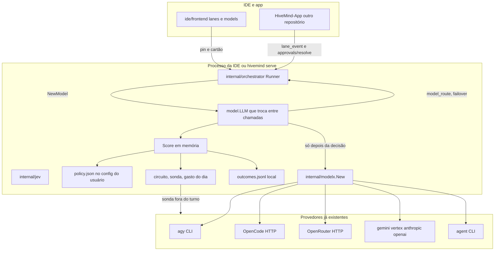

# Spec — Jev, orquestrador de modelo e de saúde dos provedores

**Status:** Fases 1 a 5 + provedor oficial **TypeSafe AI (`typesafe`)** implementadas. O classificador nasce ligado; arquivo sem a chave fica ligado e `classifyEnabled: false` explícito continua desligado. Pendências remanescentes (expor Vertex AI na UI e failover opcional no Residente) e melhorias de arquitetura/resiliência estão consolidadas em [`docs/specs/06-jev-router-resilience-and-telemetry.md`](specs/06-jev-router-resilience-and-telemetry.md) e [`docs/specs/PLANO_IMPLEMENTACAO.md`](specs/PLANO_IMPLEMENTACAO.md).
**Data:** 2026-11-20
**Escopo:** o lado Hive deste repositório (`hivemind-go`): CLI, HiveMind IDE (Go + Wails) e o processo que `hivemind serve` já sobe. O app Android (`HiveMind-App`, outro repositório) só entra como cliente do contrato que já consome. Esta spec não desenha tela nativa do app. Desenha o que o host passa a emitir e o que o app precisa reconhecer.

O Jev fica **acima** de todo papel do squad (gerente, tech lead, arquiteto/Chefe, dev e QA). Ele não escreve código, não chama ferramenta de arquivo e não substitui o loop do `internal/orchestrator`. Ele escolhe, por tarefa e por passo, qual provedor e qual modelo usar, e troca de provedor quando o atual adoece, sem perder a execução e sem saltar em silêncio para um modelo fora do orçamento.

## 1. Decisões

1. O Jev **envolve** o `Runner` que já existe. Não é um `team.Agent`, não entra em `Runner.build` como mais um papel e não reimplementa `sequentialagent`, `parallelagent` nem `loopagent`. O gancho é o que o runner já tem: `Runner.NewModel` (`internal/orchestrator/orchestrator.go`, `modelFor`). A IDE (`ide/internal/idecore/runner.go`) e a CLI passam a injetar aí um `model.LLM` que roteia. Os testes que já substituem `NewModel` continuam válidos.
2. O caminho quente da escolha é Go puro, no binário estático (`CGO_ENABLED=0`, Go 1.26). Não há chamada de modelo, não há HTTP e não há subprocesso dentro da decisão. Catálogo, circuito e gasto do dia já estão em memória. A decisão devolve em no máximo **5 ms** no p99 (cálculo em si: **2 ms**). Estourar esse teto é defeito, não “está lento hoje”.
3. O padrão, quando o Jev escolhe, é o **mais barato que ainda cabe** na tarefa (`auto`, flash, slug barato do OpenCode Go ou do OpenRouter). Modelo forte só sobe por escalada com motivo do host, ou porque a pessoa fixou. Um texto de arquivo, de ferramenta ou do próprio modelo pedindo “use o modelo mais caro” não muda a rota.
4. O pin da pessoa vence o automático. Ordem: pin do agente em `.hivemind/team.yaml` (provider diferente de `jev` e model diferente de `auto`), depois pin de papel em `policy.json`, depois o automático. Time já gravado não muda sozinho. Time novo, quando a fase 1 estiver ligada, nasce com `provider: jev` e `model: auto`.
5. Falha transitória continua no provedor. `internal/modelx/retry.go` (408/429/5xx, no máximo 4 tentativas, `Retry-After` com teto de 30 s) e o backoff do `agy` (`AGY_ERROR` com `retryable`) rodam **antes** do Jev desistir daquele provedor. O Jev não soma um segundo retry em cima desses.
6. A troca de modelo acontece **entre chamadas** `GenerateContent`, com a sessão `internal/sessionx` intacta. Ferramenta que o ADK já executou não corre de novo. O Cursor não é equivalente aos outros: o CLI edita o workspace sozinho (`internal/modelx/cursor.go`). Troca que envolva Cursor só no começo de um passo de papel, e um segundo escritor não entra na mesma worktree sem aprovação.
7. Subir para um modelo cujo custo estimado da próxima chamada passe `autoEscalateUsd` (padrão US$ 0,02) ou `maxEscalateRatio` (padrão 3× o teto da faixa barata daquela classe), ou que estoure o teto diário do provedor, exige o cartão `approval_required` que já existe. Sem resposta, contexto cancelado ou `false` nega. O run fica no modelo barato ou para, se o barato estiver morto. Nunca há troca silenciosa para um modelo muito mais caro.
8. Segredo não entra no Jev. Chave continua em `internal/modelx/keys.go` (`api-keys.json` via `EnvOrStored`) e, no OpenCode, em `credentials.json` (`LoadOpenCodeCredentials`). O `agy` segue na sessão do CLI. O Jev não copia esses arquivos para prompt, log, evento, catálogo nem `policy.json`.
9. Quem pode receber o repositório é decisão da máquina, não do repositório. `policy.json` mora no diretório de config do usuário. Um `.hivemind/jev.yaml` no projeto só pode **negar** provedor. Não aumenta teto, não liga provedor e não altera peso.
10. Não há rota HTTP nova. Explicação, failover e esgotamento são `kind` novos no `orchestrator.Event`, que o bridge já publica como `lane_event` (`ide/internal/remote/hub.go`) e o relay já encaminha cifrado (`docs/SPEC_RELAY.md`). Aprovação de orçamento reusa `POST /api/v1/approvals/resolve`. Com a lane ociosa, um tipo SSE a mais, `provider_health`, avisa quota e “todos esgotados”.
11. O residente de `docs/SPEC_HIVE_AGENT.md` não é o Jev e não herda o pin do squad. Ele pode chamar a mesma função `Route` numa fase posterior. Ghost text e Ctrl+K (`ide/internal/idecore/inline_ai.go`, `ResolveInlineModel`) ficam de fora: exigem provedor HTTP com streaming e um orçamento de latência menor que o de um turno do squad.

Alternativa menor, se a implementação for cortada: só a fase 1 (catálogo em cache, `Score` em Go, evento `model_route`, opt-in `provider: jev`). Saúde, failover, escalada e classificador ficam de fora até alguém pedir a fase.

## 2. O que já existe e o Jev reutiliza

| Peça | Onde | O que o Jev faz com ela |
| --- | --- | --- |
| Loop do squad, papéis, orçamento do dev | `internal/orchestrator/orchestrator.go` (`modelFor`, `checkDevGuard`, `recordQAStall`, `qa_approve`) | Continua sendo o loop. O Jev só entrega o `model.LLM` e observa o desfecho (`qa_approve`, `qa_request_changes`, erro, guarda de token). |
| Compactação no turno | `internal/orchestrator/context_guard.go` | Roda antes da próxima chamada, como hoje. O Jev estima a janela **depois** da compactação. Ele não resume arquivo. |
| Fábrica | `internal/modelx/factory.go` `New` | Único construtor. Provedores: `agy`, `opencode` (também `opencode-go` / `zen`), `gemini`, `vertex`, `anthropic`, `openai`, `openai-responses`, `openrouter`, `cursor`. |
| Catálogo OpenRouter | `internal/modelx/openrouter_models.go` `OpenRouterModels` | Já traz `id`, `context_length`, preço de prompt e de completion. TTL em memória de 30 min. O Jev persiste a última resposta boa e não bloqueia o turno na rede. |
| Catálogo Cursor | `internal/modelx/cursor.go` `ListCursorModels` (`agent models`) | Slugs da conta. `auto` permanece o primeiro. Falha do CLI não apaga a lista anterior. |
| Catálogo agy | `internal/modelx/agy.go` `ListAgyModels` (`agy models`) | Idem. Preço por token não existe; a conta é a Google Pro. |
| Catálogo OpenCode | `internal/modelx/opencode.go` `fetchOpenCodeCatalog` | Protocolo e `base_url` por modelo. O default barato de hoje (`deepseek-v4.1-flash` no Go, `big-pickle` no Zen) entra como semente da faixa barata. |
| Retry HTTP | `internal/modelx/retry.go` | Esgota antes do circuito abrir. |
| Quota oficial | `internal/modelx/usage.go` (`FetchAgyUsage`, `FetchOpenCodeUsage`, `RecordAIUsage`, `ai-usage.json`) | Sonda fora do caminho quente. O ledger de token continua lá. O Jev não cria um segundo contador de token. |
| Chaves | `keys.go`, `credentials.json` do OpenCode | Leitura só dentro de `modelx.New` e das sondas que já existem. |
| Time | `internal/team/team.go` `Agent.Provider`, `Agent.Model`, `NormalizeProvider` | Pin por agente. `inferProvider` já reconhece `cursor:`, `agy:`, `opencode:` e id com `/` como OpenRouter. |
| Sessão | `internal/sessionx` | Fonte da retomada. O Jev não grava sessão paralela. |
| Evento e bridge | `orchestrator.Event`, `ide/internal/remote` `StreamEvent`, `docs/SPEC_APP_MOBILE_NATIVO.md` §5 | Mesmo SSE, mesmo quadro cifrado do relay. |
| Aprovação | `ide/internal/idecore/runner.go` `SessionManager.RequestApproval` | Cartão de orçamento. `Emit == nil` já devolve falso; o Jev trata falso como negado. |
| Modelo de teste | `internal/modelx/scripted.go` | Os testes de roteamento e de failover usam este modelo, não a rede. |

Lacuna que a fase 1 corrige no ledger, sem mudar o significado dos outros baldes: `CanonicalUsageProvider` (`usage.go`) não tem caso `cursor` e cai no `default`, que devolve `agy`. Gasto do Cursor não pode entrar no balde do agy. O balde novo é `cursor`.

O achado de dogfooding em `docs/ROADMAP.md` (janela do agy pequena demais, ~1,2M tokens no agente de coordenação) é o motivo deste desenho. A compactação continua em `docs/SPEC_REVISAO_CONTEXTO.md`. O Jev não a substitui: ele evita mandar esse contexto para um modelo que não cabe, e evita pagar um modelo forte para um passo trivial.

## 3. Arquitetura



O squad continua a produzir plano, patch, teste e `qa_approve`. O Jev não aparece como autor de ferramenta. O nome `jev` não é um agente ADK e não pode ser passado em `team.Agent.Name` (o ADK reserva `user`; `jev` fica reservado pelo host para o roteador, para não colidir com um dev batizado assim).

Dois momentos, e só o primeiro segura o turno:

1. **Decisão.** `Route` lê classe, papel, janela estimada, pin, circuito e gasto. Devolve provedor, modelo, faixa e códigos de motivo. Sem rede.
2. **Chamada.** O wrapper pede `modelx.New` e repassa `GenerateContent`. Se a chamada voltar erro já classificado, e o retry daquele provedor tiver acabado, o wrapper escolhe o próximo candidato e repete **aquele** pedido. Se a chamada voltar tool call, o ADK executa as ferramentas do Hive, como hoje. A próxima decisão é outro `GenerateContent`.

O refresh do catálogo, a sonda de quota (`agy models` / `agy` usage, `agent models`, `GET /models` do OpenRouter, catálogo e usage do OpenCode) e a gravação de `outcomes.jsonl` correm numa goroutine com o último snapshot servindo o turno. Primeira execução, sem snapshot em disco, usa a tabela estática da seção 6 e dispara o refresh em seguida. O turno não espera os 15 s do `OpenRouterModels`.

## 4. Pacote

```
internal/jev/          Route, Score, circuito, gasto, catálogo em memória
internal/jev/jev_test.go
```

`internal/jev` não importa `ide/`, não chama `net.Listen`, não executa shell e não lê chave. Quem fala com a rede continua sendo `modelx`. Um teste falha se algum arquivo do pacote referenciar `Listen`, `api-keys.json`, `credentials.json` ou `EnvOrStored`.

```go
type Class string // "trivial" | "planning" | "coding" | "review" | "qa" | "vision"

type Complexity string // "low" | "medium" | "high"

type Task struct {
    Role         string // papel já normalizado por team.NormalizeRole
    RunMode      string
    Class        Class
    Complexity   Complexity
    InputTokens  int
    NeedsTools   bool
    NeedsVision  bool
    QAStall      int
    RepoKey      string
}

type Choice struct {
    Provider        string
    Model           string
    Tier            string // "cheap" | "mid" | "strong"
    Reasons         []string
    EstimatedMicroUSD int64
    DecisionMicros  int64
}

type Refusal struct {
    Code   string // "none_fit" | "budget" | "allowlist" | "circuit" | "pin_down"
    Need   Choice // candidato bloqueado pelo teto, se houver
}
```

`Score(task, catalog, health) (Choice, Refusal)` é função pura. O wrapper é o único lugar que chama `modelx.New`.

## 5. Classificação da tarefa

A classe sai de sinais do host, nesta ordem. Não sai de um modelo.

| Sinal | Classe | Complexidade |
| --- | --- | --- |
| Anexo com `image/*` em `orchestrator.Attachment` | `vision` | a da linha que casaria sem o anexo |
| Papel `qa`, ou `runMode` de auto-review | `qa` | `low`, ou `high` se `recordQAStall` já contou nesta rodada |
| Papel `project_manager`, `tech_lead` ou `architect`, e o passo é plano (`chief_plan`, `tech_lead_plan`, `architect_plan`) | `planning` | `low` se o objetivo tem menos de 800 caracteres e a sessão ainda não passou de 20 mil tokens de entrada; senão `medium`; `high` se a entrada estimada passa de 100 mil |
| Triagem do Chefe (`runTriageChief`) com objetivo curto, sem anexo | `trivial` | `low` |
| Papel `developer` | `coding` | a mesma régua de tokens e de tamanho do objetivo; `QAStall >= 1` sobe para `high` |
| Qualquer papel com objetivo curto pedindo só ajuste pontual e entrada abaixo de 20 mil | continua a classe do papel | `low` |

`NeedsTools` é verdadeiro para dev, QA e para qualquer passo que já tenha ferramenta no agente. Planejamento puro do Chefe na triagem pode ir sem ferramenta. `NeedsVision` exige modelo com visão no catálogo. Se nenhum modelo barato tem visão, a escalada para um que tenha pede aprovação quando o preço passar o teto. Não se descarta o anexo em silêncio.

A janela estimada é a última entrada medida em `recordUsage` para aquele autor, ou, no primeiro passo, um teto conservador: sistema e ferramentas do papel (o que o ADK já vai mandar) mais o objetivo mais o bloco de memória de no máximo 4 KiB de `.hivemind/MEMORY.md`. O número não precisa ser exato. Precisa impedir escolher um modelo cuja `contextLength` seja menor que `InputTokens * 1,2`.

O classificador por modelo barato é a fase 5 e nasce ligado. Ele só pode refinar `Class` e `Complexity` quando o heurístico marcou confiança baixa (objetivo longo sem verbo reconhecível e papel ambíguo). A resposta dele é um enum, validado por lista fechada. Texto fora do enum, falha da chamada ou modelo indisponível descartam a resposta e vale o heurístico. Ele não escolhe provedor, não vê chave e não corre no caminho dos 5 ms. Quem nunca gravou `classifyEnabled` fica ligado. Quem gravou `false` continua desligado.

## 6. Catálogo

Um registro por par provedor+modelo:

| Campo | Origem |
| --- | --- |
| `provider`, `model` | id estável, o mesmo que `modelx.New` aceita |
| `contextLength` | OpenRouter, catálogo OpenCode, ou a tabela estática |
| `promptMicroUSD`, `completionMicroUSD` | preço por token em microdólar. OpenRouter já entrega string decimal em `OpenRouterModel`. Zero significa “não medido”, não “de graça”. |
| `capabilities` | `tools`, `vision`, `stream`. Cursor: `tools` falso para o ADK (as ferramentas são do CLI) e `workspaceAgent` verdadeiro. |
| `latencyP50` | medido neste PC, em ms, das últimas chamadas bem sucedidas. Sem amostra, o valor estático. |
| `quality` | 0 a 1. Prior estático até haver 8 desfechos locais daquele par naquele `repoKey`. Depois, metade prior e metade taxa local. |
| `dataClass` | `cli_account` (`agy`), `http_api` (OpenCode, OpenRouter, Gemini, Vertex, Anthropic, OpenAI), `workspace_agent` (`cursor`) |
| `source`, `refreshedAt` | `static`, `openrouter`, `opencode`, `agy`, `cursor` |

Tabela estática mínima, usada sem rede e quando o refresh falha. Não é a lista viva. É a semente para o padrão barato não ficar vazio:

| Provedor | Modelo semente barato | Notas |
| --- | --- | --- |
| `opencode` | o default que `NewOpenCode` já usa (`deepseek-v4.1-flash` no Go) | preço 0 até o catálogo preencher |
| `openrouter` | um slug flash já aceito pela conta, gravado na policy quando a pessoa salvar; senão o mais barato do último `OpenRouterModels` com `tools` e janela ≥ 32 mil | vazio se não houver chave nem snapshot |
| `agy` | `agy` (`auto` da conta) | custo em dólar 0; limitado pela quota de `FetchAgyUsage` |
| `cursor` | `auto` | custo em dólar 0 (assinatura); `workspaceAgent` |
| `gemini` | o flash que o time já documenta (`gemini-flash-latest` no README, quando há `GOOGLE_API_KEY`) | só entra se a chave existir |
| `anthropic`, `openai`, `openai-responses`, `vertex` | nenhum semente barato obrigatório | só entram com preço conhecido e abaixo do teto, ou por pin |

Refresh, fora do turno, no máximo a cada 30 min por fonte, o mesmo TTL de `openRouterModelsTTL`. Erro de rede mantém o snapshot em disco (`catalog.json`). Id que não veio do snapshot nem da tabela estática não é selecionável. Nome de modelo vindo de arquivo do repositório, de MCP ou de ferramenta não entra no catálogo. Descrição de marketing do OpenRouter não vai para prompt nenhum.

`auto` do Cursor e `agy` sem slug são uma linha do catálogo, não um segundo roteador. O Jev escolhe essa linha quando ela ganha o `Score`. O CLI por baixo pode escolher o modelo interno dele. Isso não autoriza o Jev a assumir que o modelo interno foi o mais barato da tabela HTTP.

## 7. Score, faixas e orçamento

Faixa por classe, antes do peso:

| Classe | Faixa inicial |
| --- | --- |
| `trivial`, `planning` com complexidade `low` | `cheap` |
| `coding` `low` ou `medium`, `review`, `qa` `low` | `cheap` |
| `coding` `high`, `qa` `high`, `planning` `high` | `mid` |
| `vision` | o mais barato com `vision` |

`strong` não é faixa inicial de nada. Só aparece por pin ou por escalada aprovada.

Entram na disputa só os registros que passam todos estes filtros:

- provedor com credencial presente (sonda já feita) e circuito fechado, ou meio-aberto com uma vaga de prova;
- `dataClass` permitido para o `repoKey`;
- janela ≥ entrada estimada × 1,2;
- capacidade (`tools`, `vision`, e não `workspaceAgent` no meio de um passo ADK que já tem tool call pendente);
- gasto do dia + custo estimado ≤ teto diário do provedor;
- preço estimado da próxima chamada ≤ teto da faixa, salvo pin que já cabe no teto diário.

Custo estimado = `InputTokens * promptMicroUSD + saída prevista * completionMicroUSD`. Saída prevista: 2 mil tokens em `cheap`, 4 mil em `mid`, 8 mil em `strong`, teto duro para não premiar quem esconde o preço de completion. Preço 0 (`agy`, `cursor`, semente sem catálogo) conta como custo 0 **dentro da própria faixa**, e mesmo assim obedece à quota não-monetária (janela do agy, circuito, espalhamento). Preço 0 não ganha de um HTTP barato quando a quota do agy está abaixo de 5% restante. Preço desconhecido (0) **não** autoriza comparar com um modelo pago como se fossem iguais na escalada: sair de preço 0 para um preço acima de `autoEscalateUsd` é escalada e pede aprovação.

```
score = wQ*quality - wC*custoNorm - wL*latenciaNorm
```

Pesos padrão: qualidade 0,35, custo 0,50, latência 0,15. A pessoa pode mudá-los na policy. A soma é re-normalizada para 1. Custo e latência são normalizados pelo máximo entre os candidatos que sobraram. Empate: menor preço, depois menor latência, depois ordem estável do catálogo. O primeiro da faixa `cheap` que esteja saudável ganha de qualquer `mid` enquanto a faixa inicial for `cheap`, mesmo que o `mid` tenha qualidade maior. Qualidade só desempata dentro da faixa. É isso que torna o padrão barato de verdade.

Devs do mesmo `parallelagent` não caem todos no mesmo provedor se existir um segundo candidato na mesma faixa, com score a no máximo 0,05 do primeiro. A atribuição vale a rodada inteira, para o prefixo do prompt não mudar a cada chamada (cache do provedor, quando ele existir).

Teto diário padrão por provedor, em dólar, meia-noite UTC, gravado na policy e editável:

| Provedor | Teto diário padrão |
| --- | --- |
| `openrouter`, `opencode`, `gemini`, `vertex`, `openai`, `openai-responses`, `anthropic` | 1,00 |
| `agy`, `cursor` | sem teto em dólar; valem quota e circuito |

`max_tokens` e `max_dev_input_tokens` do `team.Settings` continuam valendo por cima. O Jev não afrouxa a guarda do dev.

## 8. Escalada, de-escalada e aprendizado

Escalada sobe **uma** faixa (`cheap` → `mid` → `strong`) e só por sinal do host:

- `qa_request_changes` na rodada, para o dev que vai refazer o passo;
- `recordQAStall` incrementou;
- a chamada voltou erro de contexto insuficiente (janela) depois de a compactação já ter rodado;
- a pessoa pediu, no cartão, um modelo mais forte.

A primeira tentativa da tarefa nova volta para a faixa inicial. O modelo forte não fica grudado no papel.

De-escalada: dois desfechos positivos seguidos daquela classe, naquele repo, no modelo escalado, fazem a próxima tarefa igual nascer uma faixa abaixo. Desfecho positivo é `qa_approve` no ciclo, ou o passo de planejamento concluído sem erro e sem estourar `checkDevGuard`. O modelo não declara o próprio sucesso.

Aprendizado local, um acréscimo em `outcomes.jsonl` (seção 12). A taxa só mistura com o prior depois de 8 amostras daquele par no `repoKey`. Amostra mais velha que 30 dias sai da conta, no mesmo espírito da poda de 31 dias de `ai-usage.json`. Não há upload. O relay não vê o arquivo.

Cache e economia de token, sem protocolo novo:

- Motivo da rota vai no evento, nunca no system prompt do squad. O prefixo estável continua estável.
- Catálogo, policy e histórico de failover não entram no prompt.
- Se a usage do provedor reportar token em cache, o empate dentro da faixa prefere o par que cacheou nesta sessão.
- Failover não reenvia a conversa do zero por outra sessão. A sessão ADK é a mesma.
- Compactação segue em `context_guard.go`. Se, mesmo compactado, só um modelo acima do teto couber na janela, o Jev pede aprovação. Não corta contexto por conta própria e não escolhe o modelo caro calado.

## 9. Saúde e failover

Cada provedor, e quando o erro for específico de um slug, cada modelo, tem um circuito:

| Estado | Significado |
| --- | --- |
| fechado | elegível |
| aberto | fora da disputa até o cooldown |
| meio-aberto | uma chamada real, ou uma sonda, pode entrar. Sucesso fecha. Falha abre de novo. |

O que abre o circuito, depois do retry que já existe:

| Classe | Como se reconhece | Escopo | Cooldown padrão |
| --- | --- | --- | --- |
| `quota` | HTTP 402 (OpenRouter já mapeia em `openRouterCheckAuth`); envelope `AGY_ERROR` 429 / `RESOURCE_EXHAUSTED`; usage do agy ou do OpenCode com restante abaixo de 5% | provedor inteiro, porque o crédito é da conta | 15 min, ou até `resetsAt` se a sonda trouxer |
| `rate_limit` | 429 que sobreviveu ao `retry.go` | modelo | 2 min |
| `auth` | 401 ou 403 | provedor | até a chave daquele provedor mudar no store. Não fica tentando a chave ruim |
| `outage` | 408, 5xx, timeout, CLI com exit diferente de zero sem ser auth nem quota | modelo; 5 seguidos no provedor sobem para o provedor | 1 min |
| `spike` | mais de metade das últimas 10 chamadas do modelo falharam nos últimos 2 min, com pelo menos 4 falhas | modelo | 2 min |

Erro 400 e recusa de política (jail, shell, aprovação negada) **não** abrem circuito e **não** trocam de modelo. Trocar de modelo não conserta prompt inválido nem permissão negada.

Sonda de recuperação é a que o produto já tem, fora do turno: `ProbeAgy` / usage do agy, `ProbeCursor`, `openRouterCheckAuth`, usage do OpenCode. Falha da sonda não marca outage. A última quota conhecida vale, com o flag `stale`. Sem nenhuma amostra, o provedor continua elegível até uma chamada real falhar.

Failover de uma chamada que voltou erro, sem tool call entregue ao ADK:

1. Classifica o erro. Abre o circuito.
2. `Score` de novo, sem o par que falhou.
3. Se o próximo cabe no teto, troca e repete o mesmo `LLMRequest` uma vez. Uma troca por chamada. A seguinte espera o próximo passo, para não varrer a tabela inteira num turno.
4. Se o próximo só existe acima do teto, emite `approval_required` com `gate: "budget"` e **não** chama esse modelo. Negado: se ainda houver candidato no teto, usa; senão emite `provider_exhausted` e encerra o passo. A worktree fica como está. Não há commit, push nem PR, a mesma regra de entrega sem `qa_approve`.
5. Emite `provider_failover` ou `provider_exhausted` com códigos, sem corpo de resposta do provedor.

Idempotência:

- Repetir `GenerateContent` que só devolveu erro é seguro para provedor HTTP e para o `agy`: quem grava arquivo é o Hive, e ele ainda não gravou.
- Tool call já presente na sessão não é executada de novo. O Jev não é um segundo executor. O teste da seção 16 trava isso com o modelo scriptado.
- Efeito externo que a ferramenta do Hive já disparou (GitHub, Jira, shell) permanece disparado. A troca de modelo não desfaz e não repete. A sessão tem o resultado.
- Cursor: antes do passo, o host anota `HEAD` e `git status` da worktree daquele dev (`internal/gitx`). Se o processo do `agent` morrer ou voltar erro, a worktree pode ter mudado mesmo assim. O Jev não dá `reset` sozinho. Ele não entrega o mesmo passo a outro escritor (`cursor` de novo, ou um dev ADK) enquanto o status diferir do que foi anotado, sem cartão. O cartão diz que a worktree está suja e pergunta se o próximo modelo pode continuar em cima dela. Negar para o passo e mantém o diff para a pessoa.

Devs paralelos: o circuito é do processo, compartilhado. Um 429 num dev tira aquele modelo dos outros na mesma hora. O espalhamento da seção 7 existe para isso não derrubar a rodada inteira.

## 10. Configuração

Arquivos fora de qualquer repositório, no diretório de config do usuário (`os.UserConfigDir()/HiveMind/jev/`, o mesmo fallback de `keys.go` e de `ai-usage.json`). Diretório `0700`, arquivos `0600`.

`policy.json`:

```json
{
  "version": 1,
  "enabled": false,
  "weights": { "quality": 0.35, "cost": 0.50, "latency": 0.15 },
  "autoEscalateUsd": 0.02,
  "maxEscalateRatio": 3.0,
  "dailyUsd": {
    "openrouter": 1.0,
    "opencode": 1.0,
    "gemini": 1.0,
    "vertex": 1.0,
    "openai": 1.0,
    "anthropic": 1.0
  },
  "cooldown": { "quota": "15m", "rate_limit": "2m", "outage": "1m" },
  "allowDataClass": ["cli_account", "http_api", "workspace_agent"],
  "repos": {
    "github.com/exemplo/privado": { "deny": ["openrouter", "cursor"] }
  },
  "pins": {
    "qa": { "provider": "opencode", "model": "deepseek-v4.1-flash", "strict": false }
  }
}
```

`enabled: false` é o padrão enquanto a fase 1 não for aceita num dogfooding. Com `enabled` falso, `modelFor` chama `modelx.New` direto, como hoje.

`repos` usa a chave `host/owner/nome` do `remote origin` quando ela existir. Sem remote, um prefixo SHA-256 do caminho absoluto, não o caminho em claro. `deny` é a interseção com `allowDataClass`: o repositório não acrescenta classe.

`strict: true` no pin faz o passo falhar se aquele par estiver com circuito aberto, em vez de cair para o próximo. O padrão do pin é `strict: false`: failover com aviso, ainda sujeito ao teto de preço.

No projeto, só isto, opcional, em `.hivemind/jev.yaml`:

```yaml
deny_providers: [cursor]
```

Campo desconhecido é ignorado. `dailyUsd`, `weights`, `allow` e `pins` dentro desse arquivo são ignorados e a IDE avisa uma linha. Um clone não aumenta o gasto e não manda o código para um provedor que a máquina negou.

No `team.yaml`, por agente, o pin explícito continua sendo `provider` + `model`. `provider: jev` com `model: auto` entrega a escolha ao roteador. `NormalizeProvider` ganha o caso `jev` na implementação; até lá o valor não é escrito por nenhum comando.

## 11. Superfícies na IDE e no app

Frontend já fatiado. A barra do agente é `ide/frontend/src/lanes.ts`. O seletor é `ide/frontend/src/models.ts` (`getProviderList` já lista agy, OpenCode Go, OpenCode Zen, Gemini, Anthropic, OpenAI, OpenRouter e Cursor; Vertex existe na fábrica e ainda não está nesse seletor). O modal de uso é `ide/frontend/src/modals.ts`. O `kind: "usage"` já chega em `ide/frontend/src/boot.ts`.

Acrescentar, sem módulo novo grande:

- Uma linha no cartão do agente: modelo que está valendo e uma frase curta montada no cliente a partir dos códigos (`cheap_default`, `pin`, `context_fit`, `circuit_open`, `qa_escalation`, `vision`, `spread`, `budget_wait`). A frase não vem do modelo.
- No seletor, a opção “Jev (automático, barato primeiro)” por agente, gravando `provider: jev` e `model: auto`.
- No modal de uso, o estado do circuito (fechado, aberto até tal hora, meio-aberto) e o gasto do dia contra o teto. Sem chave, sem corpo de erro do provedor.
- Tela curta da policy: pesos, tetos, classes de dado permitidas, negação por repositório, pins de papel. Só a UI local grava. O bridge não tem rota para escrever `policy.json`.
- Toast em `provider_failover`. Cartão em `gate: "budget"`, reusando o cartão de aprovação. Banner em `provider_exhausted`.

TUI (`internal/tui`): uma linha no fluxo que já imprime estágio, com o mesmo código. Sem painel novo na fase 1.

App: nenhum endpoint novo. O `data` de `lane_event` ganha os `kind` abaixo. O app que não os conhece mostra o `text` já redigido pelo host, que é obrigatório e curto. `provider_health` é o único tipo SSE novo, irmão de `lane_event` / `autoreview_status` / `approval_resolved` / `ping`. O relay não decifra e não precisa de rota nova; o quadro `event` já carrega o JSON. Aprovação de orçamento é o mesmo `POST /api/v1/approvals/resolve`.

`orchestrator.Event` ganha campos opcionais. Cliente antigo ignora.

| `kind` | Quando | Campos |
| --- | --- | --- |
| `model_route` | toda decisão que de fato chama um modelo | `provider`, `model`, `reasons`, `tier`, `estimatedMicroUsd`, `decisionMicros` |
| `provider_failover` | troca depois de erro classificado | os mesmos, mais `fromProvider`, `fromModel`, `health` |
| `provider_exhausted` | não há candidato no teto e a aprovação foi negada, ou ninguém está saudável | `health`, `text` |
| `approval_required` | escalada acima do teto | `gate: "budget"`, `approvalId`, `text` montado pelo host com os dois modelos e o valor |

`text` de failover, exemplo montado pelo host: “OpenRouter respondeu 429 em anthropic/claude-haiku. Seguindo em opencode/deepseek-v4.1-flash.” Sem header, sem corpo, sem chave.

`provider_health`, com a lane ociosa, no máximo um evento a cada 60 s, e na hora em que um circuito abre ou todos fecham: `{ "providers": [ { "provider", "state", "until" } ] }`. Não leva catálogo nem contagem de token por arquivo.

## 12. Métricas locais

Além de `ai-usage.json`, que continua recebendo `RecordAIUsage` com o balde certo:

| Arquivo | Conteúdo |
| --- | --- |
| `jev/catalog.json` | último snapshot por fonte. Sem descrição longa de modelo. |
| `jev/health.json` | estado do circuito, contadores do dia, `until`. Reescrito por completo, como o store de usage. |
| `jev/outcomes.jsonl` | uma linha por chamada terminada: instante, `repoKey`, papel, classe, complexidade, provedor, modelo, `ok` ou código de falha, tokens, latência, `estimatedMicroUsd`, se houve failover. Sem prompt, sem path de arquivo, sem saída de ferramenta. |

Rotação de `outcomes.jsonl` em 20 MiB, arquivo anterior único. Poda lógica aos 30 dias na hora de calcular a taxa. Tudo local. Log de diagnóstico em `.hivemind/logs/` não recebe esses registros se forem conter trecho de prompt; a linha de lá, se existir, é o mesmo código do evento.

Não há métrica remota e não há OpenTelemetry neste desenho.

## 13. Desempenho

Orçamentos medidos em teste, não meta de calendário.

| Medida | Teto |
| --- | --- |
| `Score` com catálogo de 2 mil linhas em memória | 2 ms no p99 |
| Da entrada em `Route` até o `Choice`, incluindo o lock | 5 ms no p99 |
| Rede, disco ou subprocesso nesse intervalo | zero. Disco só na goroutine de refresh e no append do outcome, depois da chamada |
| Troca de modelo, fora o tempo do próximo provedor | 50 ms para construir via `modelx.New` com cliente já montado, mais o evento |
| RAM extra do catálogo e dos circuitos | 20 MiB |
| Processo novo no idle | nenhum. Sem tick periódico abaixo de 1 s. A sonda usa o mesmo relógio preguiçoso de quem já não faz polling de 1 s no residente |

O wrapper não monta prompt. Ele recebe o `LLMRequest` que o ADK já montou. Falha ao abrir `catalog.json` cai na tabela estática e segue.

## 14. Segurança

Ativos: código do repositório, chaves em `api-keys.json` e `credentials.json`, sessão do `agy`, token do Cursor, teto de gasto, worktree.

| Risco | Resposta |
| --- | --- |
| Repositório clonado amplia provedor ou teto | `.hivemind/jev.yaml` só tem `deny_providers`. O resto é ignorado. |
| Arquivo ou ferramenta pede modelo caro, ou manda um id de modelo | A classe não lê esse texto. Id fora do catálogo é rejeitado. |
| Modelo “aprova” o próprio orçamento | `gate: "budget"` só fecha por `RequestApproval` humano. Argumento de ferramenta não carrega esse bit. |
| Chave no log, no SSE ou no catálogo | O wrapper não imprime `Authorization`. Reusa a redação que `redactSecret` já faz no Cursor. Evento leva código, não body. Teste com uma string no formato de chave dentro do erro do modelo scriptado. |
| Provedor recebe repo que não devia | Filtro `dataClass` + `deny` antes do `Score`. Cursor é `workspace_agent`: o CLI vê a worktree e a manda para fora do PC. OpenRouter e os HTTP são `http_api`. `agy` é `cli_account`. Negar a classe tira todos os provedores dela. |
| Failover repete efeito | Seção 9. Sem segundo executor. Cursor sujo não ganha outro escritor sem cartão. |
| Refresh do catálogo vira execução | A resposta é JSON de lista. Não há `eval`. Nome de modelo não é passado a `sh`. |
| Bridge grava policy | Não há rota. Quem grava é o binding da IDE, no PC. Membro remoto aprova cartão de orçamento e não edita teto. |
| Estouro de custo por laço | Uma troca por chamada, faixa sobe de um em um, teto diário, `max_dev_calls` e `max_llm_calls` intactos. |

Dado de provedor: a allowlist padrão da máquina, em produto interno (ADR-002 em `docs/ROADMAP.md`), deixa as três classes ligadas porque é o comportamento de hoje, em que cada agente já manda o prompt para o provedor pinado. A diferença é que passa a ser possível negar, e que um repo não liga de novo. Negar `workspace_agent` tira o Cursor mesmo que o agente esteja pinado nele: o pin não fura a allowlist. A IDE mostra o pin como inválido e cai no automático, com aviso.

Escalada acima do teto sem aprovação é o caso que esta spec trata como defeito de segurança, não como atalho de qualidade. O teste que simula 402 no barato e um forte de US$ 0,50 a chamada tem de parar no cartão e, sem resposta, não chamar o forte.

## 15. Fases

Cada fase só começa com a anterior aceita. Critério de saída é teste mais um cenário na IDE, no Windows, que é a máquina de uso. Nenhuma fase entra na frente do dogfooding descrito em `docs/ROADMAP.md`.

### Fase 1 — Catálogo e rota barata, opt-in

`policy.json` com `enabled` ainda falso por omissão no binário que o dogfooding usar, até a pessoa ligar. `provider: jev` / `model: auto` chama `Score` e `modelx.New`. Evento `model_route`. Balde `cursor` no ledger. Sem failover e sem classificador.

Aceite:

- Heurístico da seção 5 coberto por tabela, sem rede.
- Com dois candidatos na faixa barata, o de menor preço ganha, mesmo com qualidade menor.
- Id que não está no catálogo não sai de `Route`.
- Decisão abaixo de 5 ms no teste com 2 mil linhas.
- `internal/jev` não referencia `Listen` nem arquivo de chave.
- Evento não contém a chave plantada no nome do teste.
- Time antigo, sem `provider: jev`, chama o mesmo `modelx.New` de hoje. Teste de regressão em `modelFor`.

### Fase 2 — Circuito e failover dentro do teto

Wrapper no `model.LLM`. Retry existente termina primeiro. Troca uma vez, sessão preservada, Cursor com a regra da worktree.

Aceite:

- Modelo scriptado que falha com 429 na primeira chamada e responde na segunda: uma troca, um `provider_failover`, ferramentas do primeiro erro não existem para repetir.
- 402 no OpenRouter abre o provedor inteiro. Outro modelo OpenRouter não é escolhido. OpenCode barato, se couber no teto, é.
- 400 não troca.
- Sonda de quota com restante 4% tira o agy antes da chamada.
- Falha da sonda não abre circuito.
- Worktree suja por um Cursor que “morreu” não recebe segundo `NewCursor` nem um dev ADK sem `approval_required`.
- `git status` depois do teste de ferramenta já aplicada mostra uma escrita só.

### Fase 3 — Escalada, teto e aprendizado — implementada

Implementada em `internal/jev`. `outcomes.jsonl` fica no diretório de config do usuário (`outcomes.jsonl`, append-only, rotação em 20 MiB com um arquivo anterior). A linha guarda classe, provedor, modelo, custo estimado, latência e o veredito do QA; não guarda prompt, caminho nem segredo. Depois de 8 amostras do par provedor+modelo naquele `repoKey`, o `Score` usa metade do prior e metade da taxa de sucesso (amostra com mais de 30 dias fica de fora). Duas aprovações de QA seguidas no modelo escalado fazem a tarefa seguinte da mesma classe nascer uma faixa abaixo.

Faixa sobe com `qa_request_changes` e com stall. Cartão quando o preço passa. `outcomes.jsonl` passa a influir depois de 8 amostras.

Aceite:

- Estourar `autoEscalateUsd` emite `gate: "budget"` e não chama o modelo caro até `ResolveApproval(true)`.
- Sem resposta, o modelo caro tem zero chamadas no script, e o evento final é `provider_exhausted` ou a permanência no barato, conforme a seção 9.
- Duas aprovações de QA seguidas no modelo `mid` fazem a terceira tarefa igual nascer em `cheap`.
- Sete amostras não mudam o prior. A oitava muda, num teste com números fixos.
- `.hivemind/jev.yaml` com `dailyUsd` não altera o teto lido de `policy.json`.

### Fase 4 — UI, app e allowlist visível — implementada

O binding Wails `SaveJevPolicy` grava `policy.json` no diretório de config do usuário. O bridge não tem essa rota: um POST fora da allowlist, inclusive um caminho de policy, responde 400. O cartão do agente monta a frase no cliente a partir dos códigos (`cheap_default`, `pin`, `context_fit`, `circuit_open`, `qa_escalation`, `vision`, `spread`, `budget_wait`). `deny_providers: [cursor]` impede construir o provedor Cursor mesmo com pin.

Linha no agente, seletor “Jev”, circuito no modal de uso, policy editável só na IDE, `provider_health` no SSE.

Aceite:

- Os códigos de motivo viram a frase no cliente, com teste de frontend no mesmo Vitest que `ide/frontend` já roda.
- `POST` do bridge que não seja as rotas já allowlisted continua 400, inclusive qualquer caminho que tente gravar policy.
- Evento `provider_health` aparece no `httptest` de `ide/internal/remote/server_test.go` e não contém segredo.
- Repo com `deny_providers: [cursor]` não constrói `NewCursor`, mesmo com pin `cursor` no agente.

### Fase 5 — Classificador opcional — implementada

`classifyEnabled` nasce verdadeiro. Arquivo antigo sem a chave passa a ligado na leitura. `classifyEnabled: false` gravado fica desligado. Com a flag desligada não há chamada extra. Ligada, só um objetivo longo, sem verbo reconhecível e com papel ambíguo, pede uma resposta ao modelo barato. A resposta tem de ser duas palavras da lista fechada. Qualquer outro texto, erro ou modelo indisponível mantém o heurístico. O pedido leva o objetivo, não a policy e não a chave. O `Score` não espera essa chamada.

Ligado por padrão. Uma chamada no modelo barato, fora dos 5 ms do `Score`, só na confiança baixa. Enum inválido ou falha cai no heurístico.

Aceite:

- Com a flag desligada de propósito, nenhuma chamada extra no script.
- Arquivo sem a chave carrega o classificador ligado. Arquivo com `false` permanece desligado.
- Resposta fora do enum, erro ou modelo indisponível não muda a classe e não derruba a rota.
- O classificador não recebe chave nem `policy.json`.

## 16. Plano de teste

No `go test` que o CI já roda no Linux (com `-race`) e no Windows (`.github/workflows/ci.yml`):

- Tabela de `Score`: classe × complexidade × visão × circuito × teto × pin × allowlist.
- Catálogo: JSON falso do OpenRouter com preço e janela; lista vazia; HTTP 500 mantém o snapshot; id injetado num arquivo de workspace não aparece.
- Tempo: 2 mil modelos, p99 do `Score` abaixo de 2 ms, do `Route` abaixo de 5 ms, com relógio monotônico e sem rede (`httptest` nem sobe).
- Failover: script em `scripted.go` para 429, 402, 401, 400, timeout e sucesso. Conta chamadas por provedor.
- Idempotência: a ferramenta de escrita do teste roda uma vez quando o primeiro modelo falha antes da tool call, e uma vez quando o erro chega só na chamada seguinte, com o resultado já na sessão.
- Cursor: fake no estilo `internal/testutil/fakeagy`, que grava um arquivo e sai com erro. O segundo modelo não é construído até o cartão ser aceito.
- Orçamento: modelo de US$ 0,50 não é chamado se o teto é US$ 0,02 e ninguém aprova. Com aprovação, é chamado uma vez.
- Redação: erro do script contendo `sk-teste` e `crsr_teste` não aparece no `Event` nem em `outcomes.jsonl`.
- Policy: arquivo do repo com teto maior é ignorado. `deny` tira o provedor.
- Ledger: chamada `cursor` incrementa o balde `cursor`, não o `agy`.
- Pacote: ausência de `net.Listen` e de leitura de chave.

Teste manual no Windows, uma vez por fase, registrado em `docs/DOGSFOODING.md` quando for feito:

- Ligar Jev num time pequeno e conferir a linha “barato” no dev e no QA.
- Simular quota: apontar `OPENROUTER_BASE_URL` para um `httptest` local que devolve 402, ver o failover para o OpenCode ou para o agy, e o toast.
- Simular todos esgotados: 402 e 429 nos pares baratos e o forte só atrás do cartão. Negar no celular, pelo bridge, e confirmar que o run parou sem commit.
- Repo com `deny_providers: [cursor]` não dispara `agent`.

Não faz parte do teste desta spec chamar modelo pago de verdade nem publicar o app.

## 17. Perguntas abertas

1. O preço 0 de `agy` e de `cursor` está certo como “assinatura, não por token”? Se a conta Cursor passar a cobrar por uso além do `auto`, o catálogo precisa de uma fonte de preço que `agent models` hoje não entrega. Até lá, sair desses dois para um HTTP pago acima de `autoEscalateUsd` pede aprovação.
2. Vertex está em `factory.go` e não está em `getProviderList` (`ide/frontend/src/models.ts`). O Jev pode escolhê-lo na fase 1 se a policy o incluir, ou só depois que o seletor o mostrar?
3. `enabled: false` até o dogfooding da fase 1 evita surpresa em time novo. Confirmar se o primeiro binário com Jev já deve criar time novo em `provider: jev`, ou se isso espera a fase 1 ser aceita na IDE.
4. O residente (`docs/SPEC_HIVE_AGENT.md`) chama `Route` na fase 3 dele ou fica com a rota `auto` que aquela spec já fixou? Esta spec não o liga.
5. Ghost text permanece fora. Se um dia entrar, o teto de latência daquela chamada (hoje um HTTP com cancelamento em `inline_ai.go`) não usa o wrapper de failover, que pode esperar cartão.
6. Sincronizar `outcomes.jsonl` entre dois PCs da mesma conta está fora, como a memória do residente. Confirmar se fica fora para sempre.
7. Migrar `api-keys.json` para o cofre do sistema, pergunta já aberta na spec do residente, não é pré-requisito do Jev. O Jev não passa a ler chave por um caminho novo.

## 18. Referências

- Código: `internal/orchestrator/orchestrator.go`, `internal/orchestrator/context_guard.go`, `internal/modelx/factory.go`, `internal/modelx/retry.go`, `internal/modelx/usage.go`, `internal/modelx/keys.go`, `internal/modelx/openrouter_models.go`, `internal/modelx/opencode.go`, `internal/modelx/agy.go`, `internal/modelx/cursor.go`, `internal/team/team.go`, `internal/sessionx`, `ide/internal/idecore/runner.go`, `ide/internal/remote/hub.go`, `ide/frontend/src/models.ts`, `ide/frontend/src/boot.ts`.
- Docs: `docs/ROADMAP.md` (ADR-002 e o achado de roteamento), `docs/SPEC_HIVE_AGENT.md`, `docs/SPEC_RELAY.md`, `docs/SPEC_APP_MOBILE_NATIVO.md`, `docs/SPEC_REVISAO_CONTEXTO.md`, `docs/CURSOR_AGENTE.md`, `README.md`.
